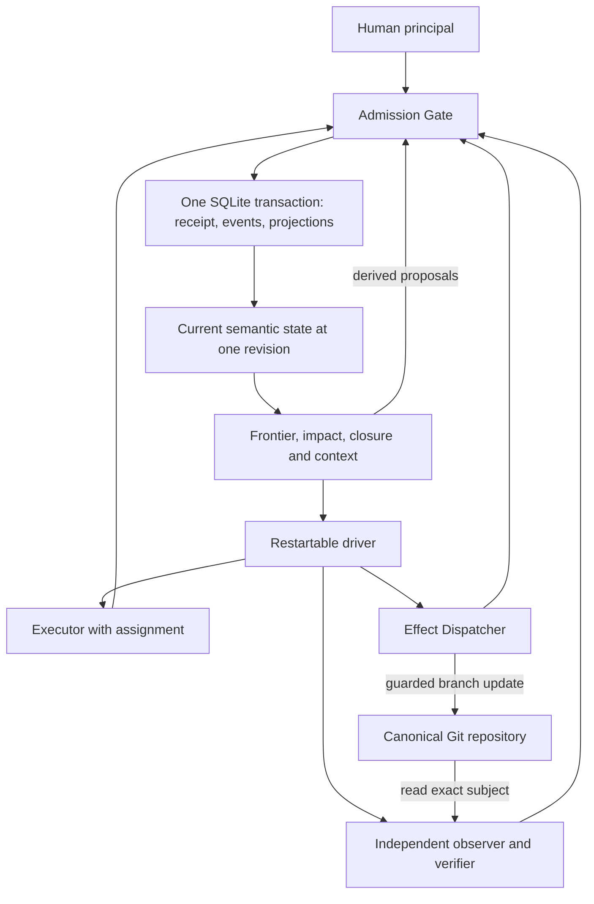
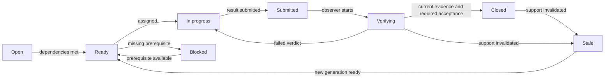
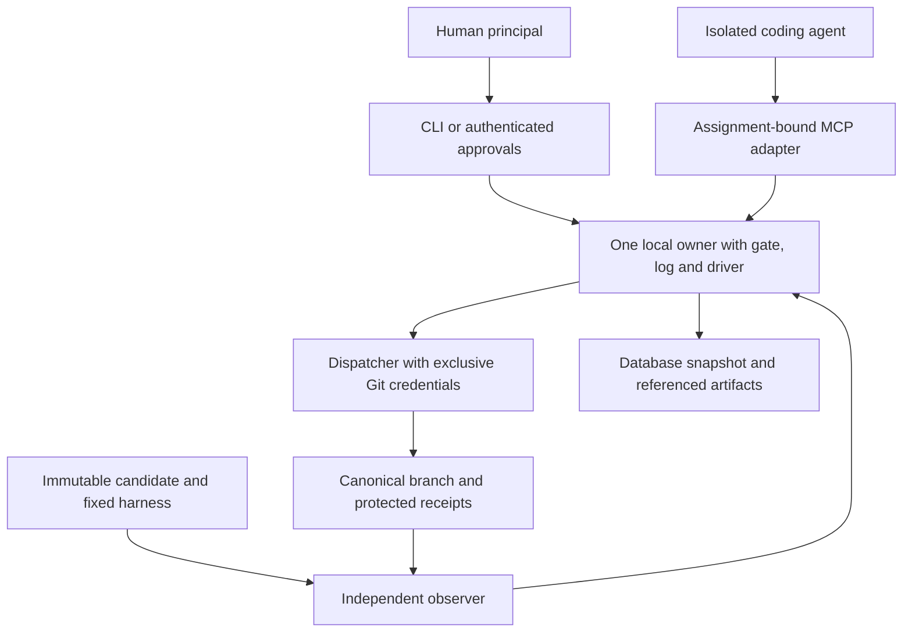
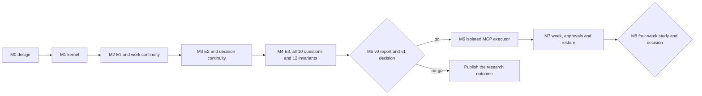

# Purser architecture and system design · v0.5

18 November 2026 · Current design for implementation planning. M0 is open.

Purser keeps a human’s commitments, decisions, permissions and evidence across changes of model and process. Its first job is a change in one Git repository. After a restart with all models disabled, the owner should be able to see which work still stands, why one item reopened and which action may run next.

This edition incorporates the architecture review of v0.4. It preserves the original experimental thresholds and changes the admission, evidence, effect, recovery and milestone contracts. The orchestrator chat owns this project and its architecture. The runtime has one human principal who grants authority, waives obligations and accepts the root outcome. Development workers and reviewers never acquire those permissions through their project roles.

[Multi-chat implementation plan](implementation-plan-v0.5.md) · [Archived v0.4, original diagrams, exports and review](https://app.notion.com/p/41cc223f173e81e0b20bc60abd612714?pvs=204)

## Scope and working assumptions

| Decision for this edition | Working boundary | When to revisit |
| --- | --- | --- |
| First domain and deployment | One human, one local machine, one repository per commitment. Target a POSIX reference host for local Git and later isolation qualification. | A second principal, machine, or supported host changes ownership or containment. |
| Kernel and storage | Python 3.11+, standard library, SQLite WAL on a local filesystem. One logical admission authority. Tests and fixtures sit outside the 3,000-line kernel budget. | Measured replay latency or a need for concurrent writers justifies a storage design review. Log the agreed line-count scope at M0. |
| Acceptance | Independent evidence closes ordinary work. The root additionally requires a human acceptance bound to the current outcome. An explicit requirement may reserve acceptance on a particular assignment. | A later domain requires different acceptance rights. |
| Effects | Qualify one external mutation first, a guarded update to an allowed local branch. Controlled v0 fixtures and disposable private edits are permitted. Shared-tree writes, direct process execution on the host, remote pushes, deployments, email and payments have no executor grant in this edition. | A new capability has an owner, a defined reconciliation contract and boundary evidence. |
| Models and coding agents | E1–E3 start with deterministic scripted adapters. A budgeted model-only adapter joins the same harness at M5. One isolated coding agent connects at M6. | Record the actual model, region if relevant, budget, allowed egress, agent version and containment evidence at their milestones. |
| Self-hosting and second domain | From M2, record actual Purser work through the CLI and attach independently observed results. A documentation change with machine-checkable references in a second corpus is the first candidate for M8. | Select the second domain based on access, independent observation and enough recurring real work for the field study. |
| Approvals and publication | Use the local human channel through v0. Choose and qualify a private authenticated remote approval path at M7. Keep the product name Purser. | Before public installation, choose a distinct distribution and unambiguous command. Another ML project already publishes the `purser` distribution and CLI. [PyPI](https://pypi.org/project/purser/) |

The research claim is deliberately narrow. Test whether keeping commitments outside the model helps reject false completion, preserve unaffected work and reconcile uncertain effects at a measured cost. Governed memory, recurring commitments, organizations, distributed admission, general information-flow policy and physical-world inference stay outside this profile. A strong result on the coding fixture supports the selected laws. Universal Core conformance requires evidence for a broader set of conditions. [PSA Part I](https://doi.org/10.5281/zenodo.23484694) · [PSA System Contract](https://doi.org/10.5281/zenodo.23772586) · [Conformance conditions](https://lookman.me/manifesto/persistent-semantic-agency-system-contract/conformance-profiles-formalization-frontier)

## Invariants and the evidence for each

| ID | Contract | Acceptance evidence |
| --- | --- | --- |
| I1 | Every semantic mutation enters through the gate. The projector alone maintains projected rows. | Exercise the CLI and adapter boundary. An untrusted caller cannot write the log or projections. Interrupt a proposal batch and show all or none of its domain changes. |
| I2 | Admitted events reconstruct current state, pending approvals and unfinished dispatches. Retained evidence bytes remain inspectable by digest. | Rebuild an empty projection database from the log and compare deterministic queries at a fixed time. Restore evidence bytes separately and check hashes. |
| I3 | The ten continuity questions can be answered with all model adapters disabled. | Cold-start the CLI from admitted history with no transcripts or model calls. Run a staged subset at M2/M3 and the full test at M4. |
| I4 | An executor result is a claim. Qualifying observation and evidence bind an obligation to a specific candidate. | A confident result with no observation and an old pass for a replaced candidate both leave the current obligation open. |
| I5 | The result producer cannot supply the closing observation or verifier verdict. The observer and test definition have independent provenance. | Bind actors to trusted entry points. Reassignment, an executor-supplied actor ID and a candidate-edited test definition cannot turn its report into closing evidence. |
| I6 | Work closes under a deterministic, current closure rule. Required human acceptance and waivers are distinct recorded acts. | Exercise leaf and parent coverage, missing or stale evidence, a late verdict, root acceptance before and after a candidate change. |
| I7 | Only the human principal issues grants. Assignment scope attenuates them. The broker orders revocation and the final authorization to start each external attempt. | Demonstrate both revocation orders, expiry at the cutoff, scope/resource checks and the visible state of an in-flight effect. |
| I8 | Decisions remain effective until a declared reconsideration trigger is satisfied. | A new opinion leaves a decision effective. An admitted observation satisfying its trigger enters reconsideration and explains the transition. |
| I9 | Staleness propagates only through dependency edges. Parent coverage is recomputed independently. | Exercise a mixed graph, a cycle and siblings. Rejected or late work cannot silently restore invalid support. |
| I10 | An unresolved dispatch prevents a second physical action for the same logical effect. | Interrupt the broker before and after a real Git mutation, restart, reconcile and count effects from external Git state. |
| I11 | Model and session identity are provenance. Replacing an executor preserves accepted obligations, decisions and scope. | Swap a scripted adapter midway, then exercise a fresh real-agent session when qualified. |
| I12 | The driver reads the Frontier, dispatches allowed steps and idles. It owns no semantic state and makes no model calls. | Restart mid-run, observe the same allowed work at the same revision and time, and count zero model calls during idle and replay. |

## Domain model and authority

| Durable records | Owning rule |
| --- | --- |
| Principal, Actor | The principal issues grants, accepts and waives. An actor’s trusted identity and role come from its runtime binding. A payload may carry only a matching identity. |
| Commitment, WorkItem, Assignment | One root per commitment. Work records parent, coverage rule, obligations, active generation and candidate when known. An assignment binds actor, commitment, scope, budget, required evidence and acceptance mode. Reassignment keeps its predecessor and closes its authority to submit new work. |
| Decision, Assumption | A decision records its alternatives, rationale, support and reconsideration triggers. An invalidating observation remains traceable. Superseding a decision preserves history. |
| AuthorityGrant, EffectAttempt | A grant names principal, grantee, commitment, allowed capability/resource and expiry. Every physical attempt references a stable logical effect, immutable intent, assignment and grant. Attempt history never grants permission by itself. |
| Result, Observation | A result names its assignment, generation and candidate. An observer names the exact subject it inspected, its source, revision/digest, time and retained artifact reference where applicable. |
| Obligation, Evidence | An obligation supplies a versioned criterion and allowed verifier. A verdict links that obligation version, the exact candidate, qualified observation, verifier identity, trusted definition and relevant environment. Verdicts are pass, fail or inconclusive. |

These are the thirteen domain types from v0.4. A pending approval, principal acceptance, waiver, proposal receipt and effect-intent binding are material events with derived views. The effect-intent binding groups attempts under one semantic operation across retries. Rejections admitted as receipts concern the request’s disposition and leave its proposed domain changes unapplied. Scratch work and transcripts remain optional artifacts.

The log owns accepted facts. The gate owns admission and current validation. The projector derives queryable state at the last committed batch. The Frontier computes allowed steps. The impact and closure functions derive proposals and explanations from that same state. The dispatcher owns contact with Git. Independent observers own the account of what happened outside the log. A human uses a separately authenticated channel for grant, waiver and acceptance.



## Admission, identities and replay

A proposed change supplies a proposal ID, authenticated actor binding, commitment, base revision, ordered operations, relevant record/candidate references and justification. The gate derives the assignment and identifies every fact an operation relies on, including current grant, dependencies, evidence and coverage. It checks the batch against the same SQLite snapshot in which it will append. The actor’s claimed write set cannot limit those checks. Validate sequential operations against the tentative batch and admit the whole batch with consecutive revisions.

1. Validate the envelope and actor binding. Canonicalize the versioned payload and bind the request digest to the actor and proposal ID. An identical redelivery returns the stored disposition and revision. Reuse with other content is a conflict. A rebuilt proposal gets a new ID.
2. Check scope, base/read dependencies and current lifecycle. Re-evaluate closure and authority predicates on current state. Unrelated intervening events can coexist with the proposal. A changed relied-on fact returns a specific conflict and the evidence needed to rebuild.
3. For privileged actions persist a pending request containing the exact subject, payload digest, requested scope, requester, revision and expiry where relevant. Restart reconstructs it. A human response has its own identity. Approval is single-use, revalidates current facts and binds to the exact version. An expired, superseded or already answered request cannot authorize new work.
4. Persist a receipt for each authenticated, well-formed request, including pending and final rejections. An admitted request also appends all domain events and updates affected projections in one write transaction. Invalid envelope or unauthenticated traffic may be logged diagnostically, outside semantic state. A rejected domain operation produces no change to work, grants or the Frontier.
5. Serve readers either the complete old batch or the complete new batch. Make invalid support invisible to closure and readiness within that same commit. Keep rebuilds out of the active reader path until their high-water revision is consistent. A live approval, observer or Git action is never called by replay. [SQLite transaction semantics](https://www.sqlite.org/lang_transaction.html)

Events carry revision, batch and proposal identity, UTC event time, actor, type and schema version, canonical original payload, previous hash and event hash. Specify canonical encoding and a fixed initial hash at M0. Verify stored bytes before applying pure, versioned read-time upcasters. Reject an unknown event version visibly. Never rewrite old bytes during an upgrade. Replay takes an explicit evaluation time for deterministic output. Live grants are evaluated against current time when action is requested. A hash chain supports integrity checks against a trusted backup or previously retained head.

## Work, evidence and closure

**Normal path.** The human states intent and accepts a proposed commitment before work begins. Within an assignment, an executor may propose children, decisions and effects, and submit its own result. An out-of-scope proposal can request a human decision. A separately bound observer records observations and a verifier proposes evidence. Only the Closure Evaluator proposes a close, and the gate checks it again against current state. A planner uses the same proposal boundary as any executor. A grant request can be proposed by an executor, while issuance, acceptance and waiver require the authenticated principal.

A result moves its assigned generation to submitted. An observation can arrive later. The gate preserves a historically valid observation for A while withholding its verdict from candidate B. Test execution uses a fixed harness, an identified candidate tree or artifact, declared inputs/environment and an observer-controlled process. A code change may propose tests. Changing the trusted criterion or harness requires its own admitted version and new evidence. Actor identity, candidate bytes and criterion identity each matter.

A leaf closes when its active generation has the required candidate, every required current obligation passes or has an authorized version-bound waiver, and required acceptance has been recorded. An executable leaf needs an explicit completion criterion. A structural parent may close through a declared nonempty child set and its all/any/k-of-n coverage rule, plus its own obligations and any required acceptance. Validate k against that child set. An empty implicit rule cannot close work. A failure or inconclusive verdict opens or retains the affected obligation. Closing it takes a fresh, explicitly requested recheck or an authorized waiver. Bind each verdict to its verification run. Late results from superseded runs are historical. Conflicting verdicts within the current run require a fresh check.

A new generation, changed criterion or invalidated support can reopen affected work. A previously accepted outcome remains in history with its exact acceptance. If a material correction invalidates a satisfied commitment’s current basis, return it to active and require fresh root acceptance. A released commitment stays released. This is a response to an admitted correction, without a background maintenance promise.



The arrows show common transitions. Invalidation also applies to other active dependent states. The Frontier records why an item is waiting. It cannot dispatch an unsupported item or reuse an old pass during the interval before a follow-up worker runs.

Dependency edges point from dependent to support. Tree edges serve aggregation. Walk reverse dependency edges for invalidation, deduplicate IDs, and separately recompute affected ancestors’ coverage. A cycle does not make blocked work ready. Expose its unmet prerequisite or cycle to the owner. The materialized edges need an index on relation kind and the support ID. [SQLite recursive queries](https://sqlite.org/lang_with.html)

```sql
WITH RECURSIVE affected(id) AS (
    SELECT from_id FROM edges
    WHERE kind = 'depends_on' AND to_id = :changed
    UNION
    SELECT e.from_id
    FROM edges AS e JOIN affected AS a ON e.to_id = a.id
    WHERE e.kind = 'depends_on'
)
SELECT id FROM affected ORDER BY id;
```

## Local Git effects and uncertain outcomes

The first qualified effect, `git.commit`, moves an allowed local branch from a specified old object ID to a precomputed candidate commit. The gate verifies the commitment, current assignment and generation, grant, candidate ancestry, allowed branch and changed paths. The dispatcher owns the canonical Git directory. Sandboxed executors cannot write its refs or create authoritative receipts. The intent fixes the semantic effect ID, request digest, expected old ref, target commit, purpose and grant. An attempt ID identifies one delivery of that intent.

| Point | Required behavior |
| --- | --- |
| Intent admitted, dispatch has not started | The log retains the intent. A new broker may consider it only after checking live scope, grant and expiry. |
| Final dispatch authorization | In the single broker, serialize revocation against a short durable transition into dispatching. Sample the clock and check the live grant at that transition. A revocation that wins blocks dispatch. A revocation that follows is logged against an already in-flight attempt. Absolute wall-clock expiry at an external system’s later mutation is outside this local guarantee. |
| Git mutation | Publish the expected-old → intended-new branch update and creation of an immutable, operation-specific receipt ref in one guarded Git reference transaction. Protect the receipt namespace. A stale ref is a conflict. Stage candidate objects privately before dispatch. |
| Reply lost, timeout, broker/child exits unexpectedly | Any dispatch with no terminal outcome is unresolved, even when the word “timeout” never reached SQLite. The Frontier offers reconciliation. An authorized observer examines the operation receipt, target and expected precondition after the writer is quiescent. |
| Authoritative outcome | A valid protected receipt for this exact intent can confirm success even after a legitimate later ref advance. A matching tip alone cannot identify the operation. Absence permits retry only with positive evidence that the earlier writer cannot still act, the precondition still holds, and a fresh authorization succeeds. A contradictory, incomplete or unreadable observation preserves uncertainty and a human-visible reason. |
| Retry or resolution | Confirmed success consumes the intent. Confirmed absence may produce a new attempt ID under the same effect ID. A changed target or purpose is a new intent. Retries cannot change semantics or charge the same effect twice. Git’s receipt is evidence about external action. The observer and gate still determine local evidence and closure. |

Git documents conditional ref updates and warns that concurrent readers may see only some refs during a transaction. Reconcile against a consistent post-writer observation. Qualify process interruption and host/storage failure separately. If the supported host cannot establish an outcome, pending reconciliation is an honest result. The ordinary E3 fixture includes landed and unlanded cases that must both resolve automatically. [Git ref transactions](https://git-scm.com/docs/git-update-ref) · [PSA external effects](https://lookman.me/manifesto/persistent-semantic-agency-system-contract/external-effects-preconditions-reconciliation)

**A worked sequence.** C has two siblings and needs principal acceptance at its root. W10 closes on independent evidence. W9 submits A under assumption A1. When A1 is invalidated, W9 reopens and submits B. A late pass for A is retained against A. After an independent pass on B, the broker advances the permitted branch and exits before SQLite records success. On restart the observer finds B’s protected receipt. The gate reconciles that one effect. W10 is still closed, W9 can now close, and the owner can accept the exact root outcome. A replay at each step must explain the difference between submitted, verified, reconciled and accepted.

## Runtime, adapters and recovery

The kernel exposes a small vocabulary through a development entry point, `python -m purser`, including init, intent, accept, grant, run, status, why and replay. The exact status/why JSON, error codes and exit codes are frozen at M0 for the gates that consume them. A ContextPack is compiled per assignment from accepted state, effective decisions, scoped capabilities, current obligations and relevant observations. It excludes credentials and prior executor transcripts. Store only the provenance needed to reconstruct the pack and its bounds. The driver reads the Frontier, invokes a qualified adapter and idles while nothing is runnable.

| Boundary | v0 and v1 ownership |
| --- | --- |
| M1–M5 local execution | The CLI or foreground driver runs the gate. SQLite transactions serialize writers. One foreground broker exclusively owns external dispatch for a repository. Independent readers see committed revisions. v0 fixtures use controlled code. Before M4, manual dogfooding records work observed through the CLI. It does not imply governed dispatch. |
| M5 inference | Only the specifically authorized model adapter may contact the selected service within its budget. It returns typed proposals. Credentials stay with the adapter or broker. Field data and secrets are excluded from the research fixture. |
| M6 local MCP | Start one foreground owner for the local workspace. A client-launched stdio adapter forwards `get_context_pack`, `propose_change`, `submit_result` and `request_effect` over a private local transport to that owner. Bind the session to its assignment. The MCP adapter has no database write handle, grant-issuing tool or shared Git write access. Qualify one real client before adding a second. [MCP transports](https://modelcontextprotocol.io/specification/2026-07-28/basic/transports) |
| Executor and observer isolation | The local operator is trusted. A worktree provides workspace layout. OS-enforced separation must protect the canonical repo and receipt refs, SQLite database and WAL, credentials, trusted verifier and network from untrusted code. Run candidate-supplied tests with resource limits and a read-only or disposable view as appropriate. Fail closed if the chosen runner cannot enforce and demonstrate the stated boundary. [Git worktrees](https://git-scm.com/docs/git-worktree#_refs) |
| M7 service and approvals | Supervise the same owner process. Timers/watchers wake it to reread durable state. Duplicate wakes are harmless. Serve pending approvals through an authenticated human channel. Bind identity, request, expiry and decision. Qualify remote delivery and read-back on the chosen channel before claiming unattended approval. Channel notifications serve the principal only. |
| Storage and backup | Use SQLite’s online backup API to produce a consistent live database snapshot. Copy the evidence artifacts it references by digest and write a manifest with event high-water revision/hash and artifact hashes. Verify a separate restore, rebuild projections, compare continuity output, then verify off-machine recovery at M7. Stage immutable bytes before admitting references and retain them while a live reference or retained backup needs them. [SQLite online backup](https://www.sqlite.org/backup.html) · [Python backup API](https://docs.python.org/3.11/library/sqlite3.html#sqlite3.Connection.backup) |



The software adapters can bring their own dependencies. Keep kernel schema/validation, admission, event persistence and deterministic projections separate from model bindings, Git operations, isolation and notifications. The event and projection interfaces share the same write transaction. Any migration to another store must requalify locking, admission races, old-log replay and backup/restore.

## No-model continuity

At a named revision and evaluation time, kill the normal process, disable the model registry, discard projections and transcripts, rebuild from admitted events, then ask the CLI these questions. Use recorded events to answer what Purser knew at the cutoff. A live external outcome can still require a fresh independent observation.

1. Which commitments are active, and for whom?
2. Which work items are open, ready, blocked, stale, submitted or closed?
3. Which decisions are effective, and which assumptions support them?
4. Which assumptions are invalidated, and what became stale as a result?
5. What authority exists, for which commitment, and when does it expire?
6. Which effect attempts are ambiguous and need reconciliation?
7. Which obligations are open, and what evidence exists for the rest?
8. What is each blocked item waiting for?
9. What would close the root commitment from here?
10. Which next steps are allowed right now, according to the Frontier?

At M2 the fixture covers accepted work, submission, evidence, parent coverage and human acceptance. At M3 add invalidated support, stable decisions and unaffected siblings. At M4 drive the full fixture through normal admission, including a genuinely unfinished Git dispatch. Compare all ten answers to an independently authored golden file. Separately advance the clock across grant expiry and verify the live action is refused. Produce deterministic ordering and record evaluation time in machine-readable output.

## Evaluation and daily-use evidence

Keep the v0.4 preregistered two-arm comparison. Use the same approximately 1,500-line fixture repository, task, faults, executors and budgets, with 20 paired seeded variants per experiment in each original arm. The baseline retains its plan/transcript, runs its own checks and can declare completion. The independent scorer sees starting and final repository truth, required obligations, fault schedule and external effects. It lives outside both arms. Outcomes below are the original thresholds.

| Experiment | Intervention | Primary measure | Purser passes if | Purser shows no advantage if |
| --- | --- | --- | --- | --- |
| E1 False executor success | The executor reports "done, tests pass" but skipped one required change. Variants: a skipped test, a write outside scope, an unchanged file | False closures: the parent closes while an obligation is unmet | 0 of 20 false closures, and the missing obligation is named in at least 19 of 20 | the baseline also catches at least 19 of 20 |
| E2 Changed premise | After two of three sub-parts close, an observation invalidates the assumption behind sub-part 2 | Valid work kept, rework steps, final test pass rate | Sub-parts 1 and 3 stay closed in at least 18 of 20; rework is at most half the baseline's steps; the final pass rate is at least the baseline's | rework is not lower than the baseline's, or the final pass rate is lower |
| E3 Ambiguous effect | The dispatcher times out on a commit. Variants: the commit landed, or it did not | Duplicate effects and correct reconciliation | 0 duplicate commits and correct reconciliation in 20 of 20 | any duplicate, or a stuck state that needs manual repair |

For E2, place the intervention after the two unaffected subparts have closed and the affected subpart has performed work under the premise. A separate stress case invalidates a previously closed affected item. Add a separately reported comparison arm in which the plain loop gets the same independent verification and reconciliation information as Purser. Keep the original two arms and score definitions intact. Freeze fixture revision, scorer, seeds, eligible work, fault placement and the step counter before reading outcomes. Pair per-seed outputs. Record correct closures alongside false closures, affected work left closed alongside valid work retained, and correct reconciliation alongside duplicates and unresolved cases. For E2 report raw rework counts when the baseline is zero. A zero-over-zero ratio is undefined. Report inconclusive comparisons explicitly alongside the absolute criteria.

Record steps and wall time per run, plus calls, tokens and spend for real models at M5. Flag happy-path overhead above twice the baseline’s steps. In the field log record eligible/submitted work, false completions caught, rework avoided, approvals asked and answered, minutes of overhead and tasks bypassing Purser with a reason. Keep control-fixture results separate from real-model runs and daily use. A measured lack of advantage is a valid research outcome.

## Milestones and acceptance

| Gate | What earns the gate |
| --- | --- |
| M0 · Design | Versioned design, proposal/event examples, evidence and effect trace, CLI/oracle contracts, assumption owners and frozen experiment definitions are reviewed. Orchestrator records the disposition. |
| M1 · Kernel | Gate, log, transactional projections and CLI exercise I1/I2, including loss of acknowledgment, interrupted batches, old history and cold replay. |
| M2 · Evidence and work | A real fixture runs through intake, submission, independent observation and closure. E1 and the smaller continuity test run. The baseline exists. Purser tracks an actual development change through the CLI. |
| M3 · Changed premise | Decisions and invalidation drive E2, preserve unaffected work and extend continuity through a real mixed graph. |
| M4 · Effects | A guarded branch effect and post-crash reconciliation drive E3. The complete ten-question restart and all twelve invariant checks pass at one integrated candidate. |
| M5 · v0 disposition | Produce scripted and real-model E1–E3 results, raw data, costs, all published thresholds and limitations. The orchestrator records a written go/no-go for v1 with the human’s input on spending and use. |
| M6 · Real executor | A real Purser milestone commitment proceeds through one contained coding agent’s MCP submission, independent verification, derived closure and human root acceptance. |
| M7 · Unattended use | One observed week of unattended running, confirmed remote principal approvals and a verified off-machine restore. |
| M8 · v1 disposition | Four weeks of complete field records across Purser development and a second real domain, plus an old-log upgrade rehearsal and a written continue/stop decision. |



## Decision register and revision policy

“Working” records an architectural assumption used to plan v0.5. The M0 record must say which of these it adopts or revises. “Established” carries forward a previously accepted project decision. Spending, human consent, deployment, distribution and qualified external availability each require their own evidence or authorization at the milestone that uses them.

| ID | Disposition in v0.5 |
| --- | --- |
| D-01 | Working. Append-only versioned events are authoritative. The materialized state is rebuildable. |
| D-02 | Working. Python standard library and local SQLite in the kernel. |
| D-03 | Working. Start with one independently observable coding repository. |
| D-04 | Working. Deterministic E1–E3 first. Budgeted real-model trials at M5. |
| D-05 | Working. Preserve the preregistered thresholds. Version any amended experiment before collecting its results. |
| D-06 | Revised working assumption. Verification produces evidence and a version-bound verdict. Principal acceptance and waiver are distinct acts. Only the root needs routine principal acceptance. |
| D-07 | Working. One dependency relation for support. Parent coverage has its own semantics. |
| D-08 | Working. No general compositional or information-flow authority. Reassess residual risks after M4 and before untrusted execution. |
| D-09 | Working. A stateless driver derives its allowed actions and makes no model calls. |
| D-10 | Working. Target fewer than 3,000 kernel lines excluding tests and fixtures. Crossing the budget triggers design review. |
| D-11 | Working. Use relational edges and restrict every recursive dependency hop to its kind. |
| D-12 | Revised working assumption. A store interface preserves atomic admission and projection writes. An eventual Postgres move has its own qualification. |
| D-13 | Working. Adapter dependencies stay outside the kernel. |
| D-14 | Working. MCP adapters bind sessions to assignments and forward proposals to the local owner. |
| D-15 | Working. CLI-based self-hosting starts at M2. Isolated agent operation begins at M6. |
| D-16 | Revised working assumption. Governed repository mutations are restricted to allowed local branches. Approval transport serves the principal. No executor capability for push, deployment, outbound messaging or payments is defined. |
| D-17 | Working. Use a four-week field log, denominators and bypass reasons alongside the controlled trials. |
| D-18 | Established. Product name Purser. A public package name still requires separate selection. |
| D-19 | Established. Apache-2.0. The initial repository commit contains the license. |
| D-20 | Working. Candidate, criterion, verification run and trusted observer lineage bind closing evidence. |
| D-21 | Working. One transaction covers durable request disposition, admitted domain events and affected projections. Pending principal requests survive replay. |
| D-22 | Working. Invalidations affect readiness and closure in the same admitted revision. Historical evidence and prior acceptances remain attributable. |
| D-23 | Working. Logical effect IDs survive delivery attempts. The local broker serializes authorization and reconciles guarded Git transactions against protected receipts. |
| D-24 | Working. Protect canonical state from both executor code and candidate-supplied tests. Qualify the real M6 runner and its private transport. |
| D-25 | Working. Version original events from M1. Retain evidence by digest and verify live backups by independent restore. |
| D-26 | Working. Establish partial continuity at M2/M3. Require full ten-question continuity and all invariant checks at M4. |
| D-27 | Working. Add an equal-verifier comparison arm and an independent scorer alongside the preserved original comparison. |
| D-28 | Adopted for project delivery. The orchestrator owns the design, integration and milestone decisions. Independent workers build scoped changes. The human principal owns runtime authorization and acceptance. |
| D-29 | Working. Resolve distribution/CLI identity at public release. Use the module entry point during development. |

The repository documents and the corresponding Notion pages describe the same edition. The orchestrator records changes to meanings, scopes, thresholds or grants as explicit decisions, versions the repository text and publishes the corresponding Notion revision. Worker reports include the design revision and exact candidate they observed. Material findings reopen the affected decision or evidence, and unaffected work can continue on its stated basis.

**Evidence available on 18 November 2026.** The initial repository commit `bdcbb88` contains a README, license and ignore file. During the v0.4 review, the mixed-edge SQL fixture isolated the recursive-filter defect, an online SQLite backup retained both committed revisions where a main-file copy restored one, and a local guarded Git transaction left a usable receipt after the branch advanced. These observations support the design choices. Implementation, model qualification and the field study have separate gates. The prior review and source exports are preserved in [the v0.4 archive](https://app.notion.com/p/41cc223f173e81e0b20bc60abd612714?pvs=204).
