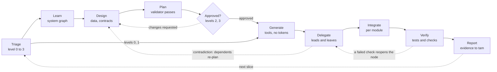
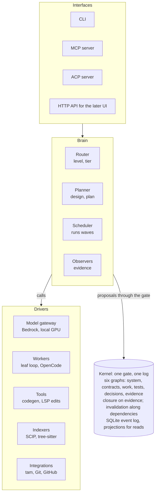
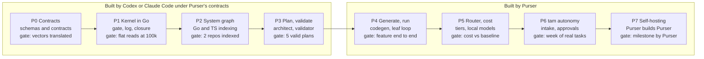

# Purser: design of an agentic engineering runtime

Nov 20, 2026 · @Luki

## Summary

Purser is an agentic engineering runtime. It takes a task from the tracker, learns the system, designs the change around data contracts, and decomposes it into a graph of work and a graph of tests. It then hands each piece to the cheapest model or tool that can do it, and closes work only on evidence.

It is built as an operating system for engineering agents, not as a chat loop. A kernel holds the persistent state: system graph, decisions, contracts, plans, assignments and evidence. Models are replaceable processors of different cost, code generators and language servers are drivers, and existing agents such as Claude Code or Codex can run as workers.

| Decision | Choice |
| --- | --- |
| Product | Own runtime, model-agnostic; not a fork of Kilo or OpenCode |
| Core | Go, single binary; language analysis out of process (LSP, SCIP) |
| Languages supported first | Go and TypeScript; Python next |
| Models | Opus 4.6 architect, Sonnet 4.6 module lead, local model then Haiku for leaves; Bedrock plus a local RTX 5070 Ti |
| Autonomy | The human approves designs only; everything else runs on its own |
| Intake | tam, through its MCP server |
| Kernel | purser-main semantics ported to Go; purser-main stays as the reference spec |
| Interfaces first | CLI, MCP and ACP; web UI later |
| License | Apache-2.0 |

This doc covers the brain, core, tools and CLI. Its last part plans Purser's own build with Purser's method, so the doc is also its first plan.

## Problem and evidence

Coding agents fail in predictable ways, and most failures come from the loop around the model, not the model itself.

- **Orientation.** In Anthropic's long-running harness work, agents tried to build everything at once, later sessions guessed at prior state, and agents declared a project done on seeing progress. [source](https://www.anthropic.com/engineering/effective-harnesses-for-long-running-agents)
- **Specification and termination.** In the MAST study, step repetition was 15.7%, unawareness of termination 12.4% and disobeying the task spec 11.8%. Verification failures added up to about 23%. [source](https://arxiv.org/abs/2503.13657)
- **False success.** ImpossibleBench found frontier models frequently exploit tests, and stronger models do it more. [source](https://arxiv.org/abs/2510.20270)
- **Design drift.** OpenAI's Codex team found agents copy existing patterns, bad ones included; cleanup took about 20% of their week until they encoded rules. [source](https://openai.com/index/harness-engineering/)
- **Context.** Chroma found model reliability falls as input length grows, even on simple tasks. [source](https://research.trychroma.com/context-rot)

The single-agent loop also wastes money that one run's token count hides. The same expensive model rereads the repo every session and writes boilerplate a generator could emit. Its unverified "done" turns into rework and follow-up sessions days later.

Lessons from purser-main, the v0.5 kernel built by Codex workers:

- The kernel works: one gate, a hash-chained log, closure on independent evidence and local invalidation. All 236 tests runnable here pass.
- Scripted experiments showed no advantage over a plain loop given the same verification, at 1.75 times the steps.
- Effort drifted toward the measuring apparatus: 17.5k lines of experiment code against a 2.5k-line kernel, and five candidates for one evaluator.
- Every read replays the whole log: 125 ms at 1,000 events, 482 ms at 2,000.
- The product loop could neither plan nor verify, so Purser never managed its own development.

## Claims and non-claims

Purser must prove five claims against the strongest practical baseline: Claude Code or Codex with AGENTS.md, an execution plan and CI.

| Claim | Mechanism | Measured by |
| --- | --- | --- |
| C1 Fewer false completions | Work closes only on the executed test graph and on checks run outside the worker | False "done" accepted, including conflicting-test traps |
| C2 Less design drift | The design compiles into contracts, layer rules and reuse directives that observers check | Out-of-scope edits, duplicate helpers, layer violations |
| C3 Lower cost per accepted change | Expensive models only at decisions; tools and small models for the bulk; small contexts | Tokens × price plus human minutes per accepted change |
| C4 Faster delivery of medium and large work | Parallel waves over frozen contracts; less rework | Wall-clock from task to accepted change |
| C5 Recovery without loss | State lives in the kernel; any session or model resumes from it | Repeated work and lost decisions after a killed run or a model swap |

What Purser does not claim:

- It does not make models smarter. Plan quality comes from the model; Purser grounds, structures and checks it.
- Best practices are enforced only where they are encoded as contracts or checks.
- One small run can cost more than a quick single-agent edit. The router keeps small tasks off the hierarchy.
- Independent verification alone is not unique. The claim is the combination of contracts, decomposition, routing and evidence in one runtime.

## Principles

Purser applies PSA's laws to software engineering; each principle is a design rule that a later section enforces. Source: [Persistent Semantic Agency, Part I](https://doi.org/10.5281/zenodo.23484694), software capability walkthrough.

1. **State outside the model.** Commitments, decisions, contracts, plans, assignments and evidence live in the kernel. A context window is a temporary view of them.
2. **Models are replaceable resources.** Any role can move to another model or worker without losing accepted state.
3. **Results are claims; evidence closes.** A worker's report never closes its own work. Executed tests and independent checks do.
4. **Contracts before code.** Every boundary that work crosses has a typed data contract before implementation is assigned.
5. **Decisions are explicit.** A choice that changes behavior is a recorded decision with alternatives. A worker that meets an undecided question escalates and never improvises.
6. **Proportional ceremony.** Process scales with size and risk. A rename never gets a design review.
7. **Tools before tokens.** Anything a compiler, language server, indexer, generator or test can do is never given to a model.
8. **Local re-planning.** A broken premise reopens only the work that depends on it. Closed, unaffected work stays closed.
9. **Minimum sufficient context.** Each worker gets exactly what its task needs: its contract, its neighbours' interfaces, the relevant decisions and the evidence expected back.

## The engineer loop

Every task runs through the loop a senior engineer follows; the router decides how much of it a task needs.

&#91;embedded content: engineer loop · 10 stages, 4 return paths\]

Levels 0 and 1 go from Triage straight to Generate; everything else passes the validator and, at levels 2 and 3, the human.



1. **Triage.** Classify the task by size and risk into level 0 to 3 (see Routing) and pick its path.
2. **Learn.** Query the system graph for the parts the task touches; read only targeted files.
3. **Design.** Decide data model changes, boundary contracts, dependencies, limits and UX states. Record each decision with its alternatives.
4. **Plan.** Produce the work graph and the test graph. The plan validator must pass (see Definition of done for planning).
5. **Confirm.** At levels 2 and 3 the human approves the design in tam; levels 0 and 1 proceed on their own.
6. **Generate.** Tools emit everything derivable from contracts: types, stubs, clients, mocks, test skeletons and wiring.
7. **Delegate.** Module leads design inside their modules, test authors write tests from contracts, implementers fill function bodies.
8. **Integrate.** When a module's children close, its integration tests run and the module closes on evidence.
9. **Verify.** The full test graph and checks run; a reviewer assesses design quality against the plan.
10. **Report and learn back.** The evidence report goes to tam, the system graph updates, and new conventions are proposed as rules.

Two return paths keep the loop honest. A worker that finds a contract unworkable files a contradiction to the contract's owner, who re-plans only the dependent region. Large features run as slices: a walking skeleton end to end first, then the rest through the same loop.

## Roles and model tiers

Each role has a fixed input, output and checker; the model behind it is configuration, so any role can move to a cheaper or stronger model.

| Role | Default model | Input | Output | Checked by |
| --- | --- | --- | --- | --- |
| Router | Local model or Haiku | Task, system graph summary | Level, path, budget | Rules; human override |
| Architect | Opus 4.6 | Task, acceptance criteria, system graph slice, targeted code | Decisions, boundary contracts, module work graph, acceptance test plan | Plan validator; human approval at levels 2–3 |
| Module lead | Sonnet 4.6 | Module contract, module slice of the graph | Function contracts, unit test specs, leaf nodes | Plan validator; conformance to the parent contract |
| Test author | Sonnet 4.6 or Haiku | Contracts only, never the implementation | Tests, frozen before implementation | Tests compile and fail on the stubs |
| Implementer | Local model, then Haiku, then Sonnet | One function contract, its tests, allowed helpers | Function body | Tests, types, lint, scope |
| Integrator | Sonnet 4.6 | Closed children, module contract | Wiring and an integration test run | Integration tests |
| Reviewer | Opus 4.6 or Sonnet 4.6, fresh context | Review package | Advisory findings | Human at level 3 |
| Tools | None | Contracts, graphs | Generated code, edits, check results | Deterministic |

Escalation rules:

- An implementer gets three attempts on its tier, then moves up one tier with the failures attached. Past the top implementer tier, the node returns to the module lead as a contract question.
- A module lead that cannot meet a boundary contract files a contradiction to the architect.
- Any role that meets an undecided behavior question escalates; no role invents behavior.
- Escalations are counted per contract, and a contract with repeated escalations is flagged for redesign.

A worker can be Purser's own leaf loop, a headless OpenCode session or Codex exec. The role contract stays the same whichever runs it.

## The graphs

Purser's state is six linked graphs in the kernel. Every role reads slices of them and writes only through the gate.

| Graph | Nodes | Edges | Built by | Updated |
| --- | --- | --- | --- | --- |
| System | Packages, modules, symbols, types, endpoints, events, tables, tests | calls, imports, implements, reads, writes, covered-by | Indexers (SCIP, LSP, tree-sitter), schema readers | After every merge, incrementally |
| Contract | Data types; function, module, endpoint, event and UI contracts | produces, consumes, refines, versions | Architect, module leads | Through admitted proposals |
| Work | Feature, module, function, wiring and spike nodes | depends-on, parent-of, implements | Architect, module leads | Through admitted proposals |
| Test | Acceptance, integration, unit and property tests | verifies, derived-from | Test authors, generators | Through admitted proposals |
| Decisions | Decisions, alternatives, assumptions, triggers | supports, invalidates, supersedes | Architect, human | Through admitted proposals |
| Evidence | Observations, verdicts, runs, reviews | about (candidate, test, contract) | Observers, reviewer | Append-only |

The two node types every worker meets, abridged:

```yaml
WorkNode:
  id: W-billing-apply-credit
  kind: function            # feature | module | function | wiring | spike
  parent: W-billing
  depends_on: [W-money-sub]
  implements: billing.ApplyCredit        # contract it must satisfy
  tier: implementer         # architect | lead | implementer | tool
  scope:
    write: [internal/billing/credit.go]
    read:  [internal/billing/**, internal/money/**]
  reuse: [money.Sub]        # must call, must not reimplement
  tests: [T-apply-credit-unit, T-apply-credit-props]
  budget: {diff_lines: 80, files: 1, attempts: 3}
  state: ready              # planned | ready | running | submitted | verifying | closed | stale | blocked

TestNode:
  id: T-apply-credit-unit
  level: unit               # acceptance | integration | unit | property
  verifies: [W-billing-apply-credit]
  derived_from: [billing.ApplyCredit]
  author: test-author       # never the implementer of what it verifies
  frozen_at: sha256:…       # candidate digest when frozen
```

The system graph is the main cost lever. The architect reads signatures, contracts and dependency summaries from it instead of files, and observers use its covered-by edges to pick regression tests.

## Data contracts

A contract is a typed promise at a boundary, written before code. It carries every decision an implementer would otherwise make silently, which is what lets small models and parallel workers succeed.

Design starts from data. The architect first fixes the data model: entities, their shapes, invariants, ownership and lifecycle. Only then does it define the functions, modules, endpoints and events that move data between those shapes.

| Kind | Defines | Source format | Generated from it |
| --- | --- | --- | --- |
| Data type | Fields, types, invariants, examples | JSON Schema (TypeSpec optional) | Go structs, TS types, Zod schemas, validators |
| Function | Signature, inputs, output, errors, side effects, pre- and postconditions, examples | Purser contract YAML over data types | Stub, doc comment, table-driven test skeleton |
| Module | Public interface, owned data, allowed dependencies, layer | Purser contract YAML | Package skeleton, interface file, import rules |
| Endpoint | Method, path, request, responses, errors, auth | OpenAPI | Server stub, client, mocks |
| Event | Topic, payload, ordering, delivery semantics | JSON Schema or AsyncAPI | Producer and consumer types |
| UI component | Props, states (empty, loading, error, ready), emitted events | TypeScript types | Component shell, story and test stubs |

A function contract, as an implementer receives it:

```yaml
contract: billing.ApplyCredit
kind: function
version: 1
module: billing
signature:
  go: func ApplyCredit(ctx context.Context, inv Invoice, c Credit) (Invoice, error)
inputs:  {inv: billing.Invoice, c: billing.Credit}
output:  billing.Invoice
errors:  [ErrCreditExpired, ErrCurrencyMismatch]
pre:     ["c.Currency == inv.Currency", "c.ExpiresAt > now"]
post:    ["result.Total == max(0, inv.Total - c.Amount)", "c.ID in result.AppliedCredits"]
side_effects: none
reuse:   [money.Sub]          # must use; no new arithmetic helpers
examples:
  - {inv.Total: "100.00 EUR", c.Amount: "30.00 EUR", result.Total: "70.00 EUR"}
  - {inv.Total: "20.00 EUR",  c.Amount: "30.00 EUR", result.Total: "0.00 EUR"}
```

Rules:

- Contracts are versioned. Changing an accepted contract is a decision, and it marks the contract's consumers stale.
- Every contract has exactly one producer and known consumers.
- Function contracts carry examples. They seed the tests and anchor small models.
- Generated code is marked as generated and is never edited by hand or by a model; it is regenerated from the contract.
- Parallel work runs only across frozen contracts.

## Definition of done for planning

A plan is done when the plan validator passes. The validator is a deterministic program, not a model's opinion, and it runs at every level before work is delegated.

All checks must pass:

1. Every acceptance criterion maps to at least one acceptance test node.
2. Every work node implements exactly one contract and has at least one test node that verifies it.
3. Every contract has one producer and at least one consumer or acceptance test, and every data type it names exists.
4. The work graph is acyclic, and every dependency points to a planned node or an existing symbol in the system graph.
5. Leaf nodes fit the leaf budget: one function or a small cohesive set, within diff and file limits, with a closed context.
6. Write scopes of nodes in the same wave do not overlap.
7. Reuse was checked: no new symbol duplicates one the system graph marks as equivalent by name, signature or similarity.
8. Layer and dependency rules from module contracts hold for every planned edge.
9. Every unknown is settled by a decision or turned into a time-boxed spike node.
10. Generated artifacts compile: stubs, types and test skeletons build, and the tests fail on the stubs.
11. Every UI component contract lists its states.
12. The cost estimate fits the task budget, or the plan carries an explicit budget request.

Check 10 is the strongest. Before any model writes a function body, the plan has become a compiling skeleton with failing tests. The validator's report is attached to the design the human approves.

## Routing and the cost model

The router puts each task on the cheapest path that can finish it correctly. Cost is measured per accepted change, including rework, follow-up sessions and human minutes, never per run.

| Level | Typical task | Path | Human |
| --- | --- | --- | --- |
| 0 | Rename, move, format, dependency bump | Tools only (language server, codemod), then tests | None |
| 1 | Bug fix or small change inside one module | Implementer or lead; a frozen failing test is the contract | None |
| 2 | Feature across a few modules | Full loop: design, contracts, graphs, waves | Approves the design |
| 3 | Cross-cutting or architectural change | Full loop with alternatives and spikes, run as slices | Approves the design and the slices |

Where the spend lands:

| Stage | Runs on | Cost driver | Lever |
| --- | --- | --- | --- |
| Triage | Local model or Haiku | Negligible | — |
| Learn, design, plan | Opus | Input reading | System graph instead of files; targeted reads; prompt caching |
| Module design | Sonnet | The module's slice | Contracts as input, not code |
| Generation and edits | Tools | Zero tokens | Codegen, language servers, ast-grep |
| Function bodies | Local, then Haiku, then Sonnet | Attempts × a small context | Contract precision; escalation rule |
| Verification | Machines | Compute | The test graph |
| Review | Opus or Sonnet | A compact package | Review package, not the repo |

The cost of one accepted change:

```latex
C = C_{\text{arch}} + \sum_{m} C_{\text{lead},m} + \sum_{f}\sum_{a=1}^{A_f} C_{\text{impl},f,a} + C_{\text{review}} + C_{\text{human}} + C_{\text{rework}}
```

Here m runs over modules, f over leaf functions, and A\_f is the number of attempts leaf f needed. The architect's term is the investment; the attempts term is where cost leaks when contracts are vague.

Purser records, per task and per contract:

- first-pass acceptance rate of leaves;
- escalations per contract;
- tokens and price by role and tier;
- human minutes;
- cost per accepted change and wall-clock to acceptance.

The router learns from these. A contract kind that local models pass reliably stays local; one that keeps escalating starts on a higher tier.

## Execution runtime

The runtime is a scheduler over the work graph. It runs every ready node on its assigned worker in an isolated worktree, in waves, and admits each result through the gate.

- **Scheduler.** Reads the Frontier: nodes whose dependencies closed and whose contracts are frozen. It groups nodes with non-overlapping write scopes into a wave, within limits on GPU slots, API rate and budget.
- **Worktrees.** One Git worktree per running node, branched from the integration branch at the plan's base. The integrator merges it back after evidence.
- **Leaf loop.** Purser's own minimal loop: build the context pack, ask the model for a function body or a patch as structured output, apply it, then compile, test and lint in the worktree. On failure it attaches the errors and retries within budget, then submits the candidate.
- **Agentic workers.** Module-level work can run on a headless OpenCode session, Codex exec or Purser's own tool loop. All receive the same context pack and submit through the same tool.
- **Context pack.** Task, contract, neighbours' interfaces, decisions, reuse targets, tests, allowed tools and budget, and nothing else.
- **Isolation.** A worker can write only its worktree. Tests run in a container (Docker; WSL2 on Windows). The kernel database, frozen tests and credentials sit outside the worker's reach.
- **Model gateway.** One interface over Bedrock for Anthropic models, OpenAI-compatible endpoints (Ollama, llama.cpp, LM Studio) and other providers. It holds per-role model config, caches stable prompt prefixes and meters tokens and price per call.
- **Daemon.** `purser serve` runs the scheduler, tam sync and the MCP and ACP servers. It can restart at any point and derives all state from the kernel.

## Verification

Work closes only on evidence produced outside the worker that made it. Observers are deterministic and run in a clean container on the exact candidate.

| Observer | Checks |
| --- | --- |
| Scope | The diff touches only the node's write scope; frozen files are unchanged |
| Build and types | `go build`, `go vet`, `tsc --noEmit` |
| Tests | The node's test nodes plus regression tests picked from the system graph's covered-by edges |
| Contract conformance | Implemented signatures and types match the contract; the contract's examples pass |
| Lint and architecture | golangci-lint with depguard; eslint and dependency-cruiser; layer rules from module contracts |
| Reuse | No new duplicate of a symbol listed in `reuse` or marked equivalent in the system graph |

Test integrity:

- A test author writes tests from contracts before implementation, and the tests are frozen by digest.
- An implementer cannot change frozen tests. A test change is a contract change with its own approval.
- Tests must fail on the generated stub, which proves they test something.
- Mutation testing can be switched on for critical modules to measure test strength.

The reviewer reads a review package, not the repo:

- the approved design and its decisions;
- the contract conformance report and observer results;
- a diff summary by module, with the full diff only for flagged areas;
- escalations and contradictions raised during the run.

Review findings are advisory. A finding that matters becomes a new work node or a contract change. The final report is assembled from verdicts, not from model narrative, and goes to tam with links to commits and PRs.

## The kernel

The kernel is purser-main's core ported to Go: one admission gate, a hash-chained event log in SQLite, projections, closure on evidence and local invalidation.

Kept from purser-main:

- One gate for every semantic change, with idempotent proposals and durable receipts.
- Append-only, hash-chained, versioned events; projections rebuildable from the log.
- Closure: a node closes only when current evidence satisfies every obligation on the exact candidate, and a producer cannot supply its own closing evidence.
- Invalidation along dependency edges only, with parent coverage recomputed separately.
- Guarded Git effects with receipts, and reconciliation of uncertain outcomes.
- No-model continuity: `status`, `why` and the Frontier answer from the log alone.

Changed:

- **Read path.** Reads come from materialized projections plus a head-hash check. Full replay runs only for `replay` and periodic verification, which removes the quadratic cost measured in purser-main.
- **New record types.** SystemNode, Contract, WorkNode (extends WorkItem), TestNode, Contradiction, RoutingDecision and CostRecord.
- **Identity.** The runtime sets a worker's identity per session; it is never taken from the worker.
- **Conformance.** purser-main's frozen wire contracts and test vectors become the Go port's conformance suite, and purser-main stays as the reference spec.
- **Quality first.** Quality and stability are the kernel's aim: conformance vectors, race-detector runs, codec and gate fuzzing, and crash-and-replay tests must pass before any release. The kernel also targets under 5,000 lines of Go, excluding tests, as a review signal, never a reason to cut tests or checks.

## Architecture

Purser is one Go binary with the kernel at the center and replaceable drivers around it. Every component reaches state only through the gate.

&#91;embedded content: architecture · interfaces, brain, kernel, drivers\]

The brain decides and the drivers do the work; nothing changes state except a proposal the gate admits.



| Component | Responsibility | Go package |
| --- | --- | --- |
| Kernel | Gate, event log, projections, closure, invalidation | `kernel` |
| System graph | Indexing (SCIP, LSP, tree-sitter), incremental updates, queries | `graph/system` |
| Contracts | Contract schemas, versioning, conformance checks | `contract` |
| Planner | Architect and module-lead sessions that produce proposals | `plan` |
| Validator | Definition-of-done checks for plans | `plan/validate` |
| Router | Level and tier selection, escalation, learning from outcomes | `route` |
| Generators | Codegen and mechanical edits as tools | `gen` |
| Scheduler | Frontier, waves, worktrees, budgets | `run` |
| Workers | Leaf loop; OpenCode and Codex adapters | `worker` |
| Model gateway | Providers, prompt caching, metering | `model` |
| Observers | Scope, build, tests, conformance, lint, reuse | `observe` |
| Integrations | tam (MCP client), Git, GitHub | `integrate` |
| Interfaces | CLI, MCP server, ACP server, HTTP API for the later UI | `cmd`, `iface` |

- **Process model.** The `purser` CLI talks to a local daemon (`purser serve`); in one-shot mode the CLI runs the daemon in process. Language analysis runs out of process (gopls, the TypeScript language server, SCIP indexers), and tests run in containers.
- **Storage.** SQLite in WAL mode holds the event log and projections, one database per workspace. Artifacts such as diffs, logs and test output are stored on disk by digest; sqlite-vec is optional for semantic search over symbols.
- **Protocols.** An MCP server exposes Purser's tools to any agent: context pack, submit, contradiction and graph queries. An MCP client consumes tam and other tools. An ACP server lets editors such as Zed, JetBrains and Neovim talk to Purser, and HTTP with server-sent events serves the later UI.

## Tools and code generation

Every tool is a typed function with a contract, run by the runtime, never a free shell command. Tools do everything that needs no judgment.

```yaml
tool: gen.openapi.go_server
inputs:  {spec: ContractRef(kind=endpoint), package: string}
outputs: {files: [path], symbols: [SymbolRef]}
effects: writes only under {package}
deterministic: true
cost: {tokens: 0}
```

| Job | Go | TypeScript |
| --- | --- | --- |
| Types from schemas | go-jsonschema or Purser templates | json-schema-to-typescript, Zod |
| HTTP from OpenAPI | oapi-codegen | openapi-typescript, orval |
| RPC | buf (protobuf, Connect) | buf (connect-es) |
| SQL | sqlc | kysely-codegen |
| GraphQL | gqlgen | graphql-codegen |
| Mocks | mockery, gomock | MSW, vitest mocks |
| Stubs and test skeletons | Purser templates (text/template) | Purser templates |
| Rename, move, signature change | gopls | TypeScript language server |
| Structural rewrite | ast-grep, `gofmt -r` | ast-grep, ts-morph |
| Format and imports | gofmt, goimports | prettier, `eslint --fix` |
| Graph indexing | scip-go, gopls | scip-typescript |

Python follows with scip-python, pyright and datamodel-code-generator. A new tool joins by registering its contract; the router can then plan it like any worker, at zero token cost.

## CLI

The CLI is the first interface. Every state is inspectable, and every command has JSON output for agents and scripts.

| Command | Does |
| --- | --- |
| `purser init` | Create a workspace and index the repository into the system graph |
| `purser index [--since <rev>]` | Refresh the system graph |
| `purser task new "<text>" [--tam <id>]` | Create a task from text or from a tam task |
| `purser triage <task>` | Show level, path and budget |
| `purser plan <task>` | Run the architect: design, contracts, work and test graphs |
| `purser validate <task>` | Run the plan validator and print failures |
| `purser approve <task>` / `purser reject <task>` | Record the human design decision |
| `purser run <task> [--parallel N]` | Execute waves until done or blocked |
| `purser status [<task>]` | Frontier, running nodes, blocked items, budget used |
| `purser why <node>` | Why a node is open, stale, blocked or closed, with its evidence |
| `purser graph <task> [--work\|--test\|--contracts]` | Print or export graphs as text, DOT or JSON |
| `purser cost <task>` | Tokens, price and human minutes by role and tier |
| `purser replay` | Rebuild projections from the log and verify the chain |
| `purser serve` | Daemon: scheduler, tam sync, MCP and ACP servers |
| `purser models` | Configured providers, tiers and health |

Output is human-readable by default, with `--json` on every command and stable exit codes. `status`, `why` and `graph` answer with every model switched off.

## Tracker integration with tam

tam is the intake and the human channel. Purser connects to it as its own agent identity through tam's MCP server.

tam's MCP tools cover creating tasks, changing status, assigning owners, commenting, linking tasks and attachments, and linking commits and PR status. Each agent gets its own identity and permissions, revocable at any time. [source](https://thetam.app/mcp)

1. **Intake.** Purser polls for tasks assigned to its identity in a ready status.
2. **Triage and plan.** Purser comments with the level. At levels 2 and 3 it attaches the design (decisions, contracts, a graph summary, the validator report) and moves the task to design review.
3. **Approval.** Purser accepts both forms: moving the task out of design review, or a comment keyword such as “approve” or “reject” with a reason. The first answer counts, and a conflicting later one is flagged to the human. Purser records it in the kernel as a principal decision.
4. **Execution.** Purser links branches, commits and PRs to the task and posts progress at each wave boundary.
5. **Done or blocked.** Purser posts the evidence report and moves the task to Done, or to Blocked with the exact question it needs answered.

The split: tam owns what, when and who; Purser owns how, and the proof. tam's own delivery agent can plan at project level while Purser takes tasks at engineering level.

## Open-source foundation

Purser builds its brain new and stands on existing projects for everything else. Check each license before embedding code.

| Need | Project | How Purser uses it |
| --- | --- | --- |
| Tool protocol | [MCP Go SDK](https://github.com/modelcontextprotocol/go-sdk) | Embedded, as server and client |
| Editor protocol | [Agent Client Protocol](https://zed.dev/acp) | Purser implements an ACP agent server |
| Code index | SCIP with scip-go and scip-typescript | Indexers run; output loaded into the system graph |
| Parsing | tree-sitter (Go bindings) | Fast structure for any language |
| Language servers | gopls, TypeScript language server, pyright | Queries and safe edits |
| Structural edits | ast-grep | A tool |
| Code generation | oapi-codegen, sqlc, buf, gqlgen, openapi-typescript, orval | Tools |
| Models | AWS SDK for Go (Bedrock); OpenAI-compatible clients | Gateway providers |
| Local inference | Ollama, llama.cpp, LM Studio | Leaf tier on the RTX 5070 Ti |
| Workers | [OpenCode](https://opencode.ai) server; Codex exec | Optional headless workers |
| Storage | SQLite, sqlite-vec | Kernel store; semantic search |
| Verification | golangci-lint, depguard, dependency-cruiser, testcontainers, Playwright | Observers |

Ideas taken, not code: beads (ready-work graph), Kiro (spec tasks run in dependency waves), Aider (architect and editor split, repository map), Parsel and AgentCoder (function decomposition, independently written tests), and the Anthropic and OpenAI harness write-ups.

Local models to benchmark first on 16 GB:

- Qwen 3.6 35B-A3B, reported at about 15 GB and 79 tok/s on an RTX 5070 Ti. [source](https://dev.to/thurmon_demich/best-gpu-for-qwen-36-in-2026-35b-a3b-moe-guide-1lp9)
- Gemma 4 12B at Q4, Kilo's pick for 12–16 GB. [source](https://blog.kilo.ai/p/the-best-local-coding-models-for)
- Flint, a mixture-of-experts model with about 40B total and 2.5B active parameters ([source](https://www.mindstudio.ai/blog/how-to-run-flint-locally/)). Its NVFP4 build is about 23 GB, so on 16 GB it needs partial offload to system RAM ([source](https://aiprofitboardroom.com/blog/flint-local-coding-model/)).

## Evaluation

Purser is judged on delivered changes against the strongest practical baseline, with costs counted end to end.

Baselines:

- **B1:** Claude Code or Codex with AGENTS.md, an execution plan and CI, on one strong model.
- **B2:** B1 plus an independent verifier running the same tests and checks Purser runs.

| Bench | Content | Tests claims |
| --- | --- | --- |
| Leaf | 100+ function contracts with tests, from real Go and TS repos | Which model passes first time; cost per leaf |
| Feature | 10–20 multi-module features with acceptance tests | C1–C4 end to end |
| Trap | Features with conflicting tests, skipped requirements, helpers to reuse, layer rules | C1, C2 |
| Recovery | Runs killed mid-wave; model swapped mid-task | C5 |

Every run records: accepted or not, false "done" accepted, out-of-scope edits, duplicates, layer violations, tokens and price by role, human minutes, wall-clock, and rework found after acceptance.

The field log decides; benchmarks catch regressions. Every real task Purser takes from tam is logged with the same metrics, plus bypasses: tasks done outside Purser and why. Results are reported even when the baseline ties, because a tie at lower cost or time is still a result.

## Building Purser the Purser way

Purser's own build follows its method. Milestones are slices that each end in something usable, modules get contracts before code, and work runs under the same rules from day one.

&#91;embedded content: roadmap · 8 slices, each with its exit gate\]

Each slice ends in something usable; the diamond line in each card is the gate that closes it.



Until P4, Purser's packages are executed by Codex or Claude Code, with the contracts and tests below as their brief. From P4 on, Purser runs its own packages, and P7 is the proof that it can build itself.

First work packages, as Purser would plan them:

| Package | Contract it implements | Tier | Proof |
| --- | --- | --- | --- |
| C1 Contract schema | `contract.v1` JSON Schema and validator | Architect, then implementer | Schema tests on the examples in this doc |
| C2 Record schemas | Event, WorkNode, TestNode, Contract records | Architect | Round-trip tests; purser-main vectors translated |
| K1 Event codec and hash chain | `kernel.Encode`, `kernel.VerifyChain` | Implementer | purser-main test vectors |
| K2 Store | `Store.Transact`, `Store.Snapshot` read from projections | Module lead | Interrupted-write and replay tests; flat read latency |
| K3 Gate | `Gate.Admit(binding, proposal) Receipt` | Module lead | Admission and redelivery vectors |
| K4 Closure and invalidation | `Closure.Evaluate`, `Impact.Affected` | Module lead | Mixed-graph, stale-candidate and late-verdict tests |
| K5 CLI status and why | `status` and `why` JSON schema | Implementer | Golden files with every model off |

## Risks and open questions

The biggest risk is the one purser-main already showed: process growing faster than the product.

| Risk | Effect | Mitigation |
| --- | --- | --- |
| Ceremony creep | Small tasks feel slow and people bypass Purser | Router keeps levels 0–1 off the hierarchy; bypass rate tracked |
| Weak contracts | Leaf retries and escalations raise cost | Mandatory examples; escalation counts flag contracts for redesign |
| Seam bugs between modules | Units pass while the system fails | Integration tests at every boundary; walking skeleton first |
| Local models underperform | Leaves escalate to paid tiers | Leaf bench sets tiers per contract kind; escalation is automatic |
| Model and tool churn | Integrations break | Role contracts and the gateway isolate providers |
| Indexing gaps | Reuse and impact checks miss symbols | Combine SCIP, LSP and tree-sitter; report coverage per repo |
| Build drift | Purser's build sprawls like purser-main's | Milestones are usable slices; no harness beyond the benchmarks |

Open questions:

- [ ] Confirm the employer-provided Bedrock access may be used for this project.
- [ ] Confirm tam MCP access for a custom client; its page lists Claude as connected and other clients in testing.
- [ ] Set leaf budget defaults (diff lines, files) from the first leaf bench.
- [ ] Choose the module path and binary name; `purser` is already taken on PyPI, so check Go and npm too.

## Later: UI and inspirations

The UI comes after the CLI. It will show what no agent UI shows today: the work graph, the test graph, contracts and evidence, live.

Planned views: a task board synced with tam; a plan view with design, decisions and contracts, plus approve and reject; a graph view of work and test nodes by state and wave; an evidence view per node; a cost view by role and tier.

Inspirations:

- **Kilo Code:** an agent manager, parallel sessions in worktrees, reach into VS Code and JetBrains.
- **OpenCode:** one server with several clients (terminal, desktop, web) over HTTP and events.
- **Antigravity:** plans, task lists and walkthroughs as reviewable artifacts with inline comments.
- **beads viewers:** graph and kanban views over a dependency graph.
- **Zed and JetBrains through ACP:** Purser inside editors without building an editor.

The web UI will be React, served by the daemon over HTTP with server-sent events; editors connect through ACP.

## Decision register

Fifteen decisions shape v1; all are accepted, with tiers and limits tuned by the first benchmarks.

| ID | Decision | Status |
| --- | --- | --- |
| D-01 | Purser is its own runtime, not a fork of Kilo or OpenCode | Accepted |
| D-02 | Core in Go as a single binary; TypeScript for the later UI | Accepted |
| D-03 | Kernel semantics ported from purser-main, which stays as the reference spec | Accepted |
| D-04 | Reads served from projections; full replay only for verification | Accepted |
| D-05 | Contracts before code; JSON Schema, OpenAPI and contract YAML as source formats | Accepted |
| D-06 | A deterministic plan validator gates delegation | Accepted |
| D-07 | Tests are written from contracts by a different role and frozen | Accepted |
| D-08 | Tiers: Opus architect, Sonnet lead, local then Haiku then Sonnet for leaves; tuned by the leaf bench | Accepted |
| D-09 | The human approves designs only, at levels 2 and 3 | Accepted |
| D-10 | Intake, approvals and reports through tam's MCP server; access to confirm | Accepted |
| D-11 | Go and TypeScript first; Python next | Accepted |
| D-12 | CLI, MCP and ACP first; web UI later | Accepted |
| D-13 | Kernel quality and stability first; 5,000 lines of Go is a review signal, not a goal | Accepted |
| D-14 | Leaf default: three attempts per tier, then escalate | Accepted |
| D-15 | License Apache-2.0 | Accepted |
