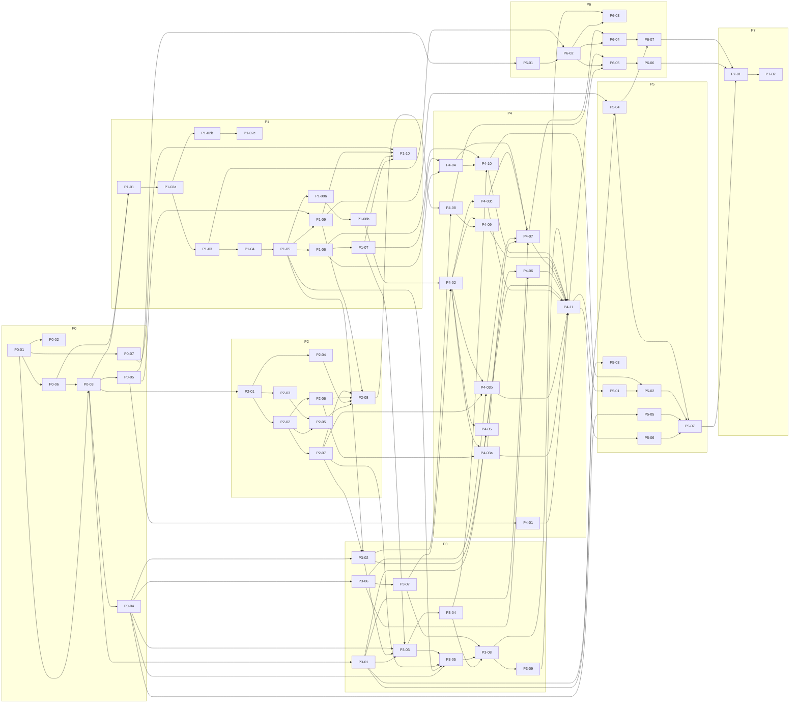

# Package index

Generated by `python3 tools/check_briefs.py --index`. Do not edit by hand.

66 packages. P0 to P2 are `ready` with full contracts; P3 to P7 are `draft` and get their contracts in each phase's planning batch.

| ID | Title | Size | Status | Builder | Tests by | Merge | After |
| --- | --- | --- | --- | --- | --- | --- | --- |
| [P0-01](P0-01.md) | Repository bootstrap | M | ready | codex | none | human | — |
| [P0-02](P0-02.md) | Scope and frozen-test checks | M | ready | antigravity | codex | human | P0-01 |
| [P0-03](P0-03.md) | Record schemas | M | ready | codex | antigravity | human | P0-01, P0-06 |
| [P0-04](P0-04.md) | Contract schema v1 | M | ready | codex | antigravity | human | P0-03 |
| [P0-05](P0-05.md) | Tool and CLI schemas | S | ready | antigravity | codex | human | P0-03 |
| [P0-06](P0-06.md) | Conformance vectors and golden logs | M | ready | antigravity | codex | human | P0-01 |
| [P0-07](P0-07.md) | Quality harness | S | ready | codex | antigravity | auto | P0-01 |
| [P1-01](P1-01.md) | Event codec and hash chain | S | ready | codex | antigravity | auto | P0-03, P0-06 |
| [P1-02a](P1-02a.md) | Store: schema and transactions | M | ready | codex | antigravity | human | P1-01 |
| [P1-02b](P1-02b.md) | Store: projection reads | M | ready | codex | antigravity | human | P1-02a |
| [P1-02c](P1-02c.md) | Store: replay and verification | S | ready | codex | antigravity | auto | P1-02b |
| [P1-03](P1-03.md) | Gate | M | ready | codex | antigravity | human | P1-02a |
| [P1-04](P1-04.md) | Work model | M | ready | codex | antigravity | human | P1-03 |
| [P1-05](P1-05.md) | Closure and work view | M | ready | codex | antigravity | human | P1-04 |
| [P1-06](P1-06.md) | Impact and invalidation | M | ready | codex | antigravity | human | P1-05 |
| [P1-07](P1-07.md) | Decisions and dispatch | M | ready | antigravity | codex | human | P1-06 |
| [P1-08a](P1-08a.md) | Effect operators | M | ready | codex | antigravity | human | P1-05 |
| [P1-08b](P1-08b.md) | Git effect adapter | M | ready | codex | antigravity | human | P1-08a |
| [P1-09](P1-09.md) | Kernel CLI | M | ready | antigravity | codex | human | P1-05, P0-05 |
| [P1-10](P1-10.md) | Kernel hardening | S | ready | antigravity | codex | auto | P1-07, P1-08b, P1-09, P0-07 |
| [P2-01](P2-01.md) | Graph store and query API | M | ready | codex | antigravity | human | P0-03 |
| [P2-02](P2-02.md) | SCIP ingestion | M | ready | antigravity | codex | human | P2-01 |
| [P2-03](P2-03.md) | Syntax fallback | M | ready | antigravity | codex | human | P2-01 |
| [P2-04](P2-04.md) | Language-server client | M | ready | codex | antigravity | human | P2-01 |
| [P2-05](P2-05.md) | Incremental update | M | ready | codex | antigravity | human | P2-02, P2-03 |
| [P2-06](P2-06.md) | Test coverage edges | M | ready | antigravity | codex | human | P2-02 |
| [P2-07](P2-07.md) | Reuse finder | M | ready | codex | antigravity | human | P2-02 |
| [P2-08](P2-08.md) | Index CLI, snapshot record and benchmark | M | ready | antigravity | codex | human | P2-05, P2-04, P2-06, P2-07, P1-09 |
| [P3-01](P3-01.md) | Model gateway | M | draft | codex | antigravity | human | P0-03 |
| [P3-02](P3-02.md) | Context pack builder | M | draft | codex | antigravity | human | P1-05, P2-07, P0-04 |
| [P3-03](P3-03.md) | Architect session | L | draft | codex | antigravity | human | P1-07, P3-01, P3-02, P0-04 |
| [P3-04](P3-04.md) | Module-lead session | M | draft | codex | antigravity | human | P3-03 |
| [P3-05](P3-05.md) | Validator: graph checks | M | draft | antigravity | codex | human | P0-04, P1-05, P2-07, P3-03 |
| [P3-06](P3-06.md) | Stub and test-skeleton generators | M | draft | antigravity | codex | human | P0-04 |
| [P3-07](P3-07.md) | Validator: compile check | M | draft | codex | antigravity | human | P3-06 |
| [P3-08](P3-08.md) | Planning CLI | S | draft | antigravity | codex | human | P3-04, P3-05, P3-07 |
| [P3-09](P3-09.md) | Planning trial | S | draft | codex | none | human | P3-08 |
| [P4-01](P4-01.md) | Generator tools | M | draft | antigravity | codex | human | P0-05 |
| [P4-02](P4-02.md) | Worktrees and isolation | M | draft | codex | antigravity | human | P1-08b, P3-07 |
| [P4-03a](P4-03a.md) | Observers: scope, build, tests | M | draft | antigravity | codex | human | P2-06, P4-02 |
| [P4-03b](P4-03b.md) | Observers: conformance, reuse | M | draft | codex | antigravity | human | P2-07, P4-02, P3-06 |
| [P4-03c](P4-03c.md) | Observers: lint and architecture | S | draft | antigravity | codex | auto | P4-02 |
| [P4-04](P4-04.md) | Scheduler | M | draft | codex | antigravity | human | P1-06, P1-07 |
| [P4-05](P4-05.md) | Leaf loop | M | draft | codex | antigravity | human | P3-01, P3-02, P4-02 |
| [P4-06](P4-06.md) | Test-author role | M | draft | codex | antigravity | human | P4-05, P3-06 |
| [P4-07](P4-07.md) | Integrator, review package and reviewer | M | draft | codex | antigravity | human | P4-03a, P4-03b, P4-03c, P4-04, P3-01 |
| [P4-08](P4-08.md) | MCP server | M | draft | antigravity | codex | human | P3-02, P2-08 |
| [P4-09](P4-09.md) | Worker adapters | M | draft | antigravity | codex | human | P4-08, P4-02 |
| [P4-10](P4-10.md) | Contradiction and local re-plan | M | draft | codex | antigravity | human | P4-04, P1-06, P3-04 |
| [P4-11](P4-11.md) | purser run, first feature | M | draft | codex | antigravity | human | P4-01, P4-03a, P4-03b, P4-03c, P4-05, P4-06, P4-07, P4-09, P4-10, P3-09 |
| [P5-01](P5-01.md) | Triage | S | draft | codex | antigravity | human | P4-11 |
| [P5-02](P5-02.md) | Tier routing and escalation | S | draft | codex | antigravity | human | P5-01, P4-10 |
| [P5-03](P5-03.md) | Local models | S | draft | antigravity | codex | auto | P3-01 |
| [P5-04](P5-04.md) | Cost metering and reports | S | draft | antigravity | codex | human | P3-01, P1-09 |
| [P5-05](P5-05.md) | Leaf bench | L | draft | antigravity | codex | human | P0-04 |
| [P5-06](P5-06.md) | Feature, trap and recovery benches | L | draft | antigravity | codex | human | P4-11 |
| [P5-07](P5-07.md) | Router learning | M | draft | codex | antigravity | human | P5-06, P5-05, P5-02, P5-04 |
| [P6-01](P6-01.md) | tam MCP client | S | draft | antigravity | codex | human | P0-05 |
| [P6-02](P6-02.md) | Intake and mapping | M | draft | antigravity | codex | human | P6-01, P1-03 |
| [P6-03](P6-03.md) | Design approval through tam | S | draft | codex | antigravity | human | P6-02, P3-08 |
| [P6-04](P6-04.md) | Progress and evidence reports | S | draft | antigravity | codex | auto | P6-02, P4-07 |
| [P6-05](P6-05.md) | Daemon | M | draft | codex | antigravity | human | P4-11, P6-02, P4-08 |
| [P6-06](P6-06.md) | ACP server | M | draft | antigravity | codex | human | P6-05 |
| [P6-07](P6-07.md) | Field log | S | draft | antigravity | codex | auto | P6-04, P5-04 |
| [P7-01](P7-01.md) | Python support, built by Purser | L | draft | purser | purser | human | P5-07, P6-06, P6-07 |
| [P7-02](P7-02.md) | v1.0 release review | S | draft | purser | none | human | P7-01 |

## Dependency graph

