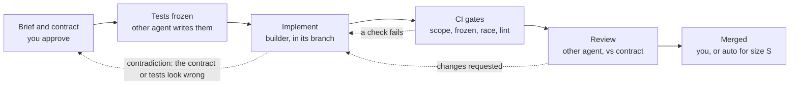
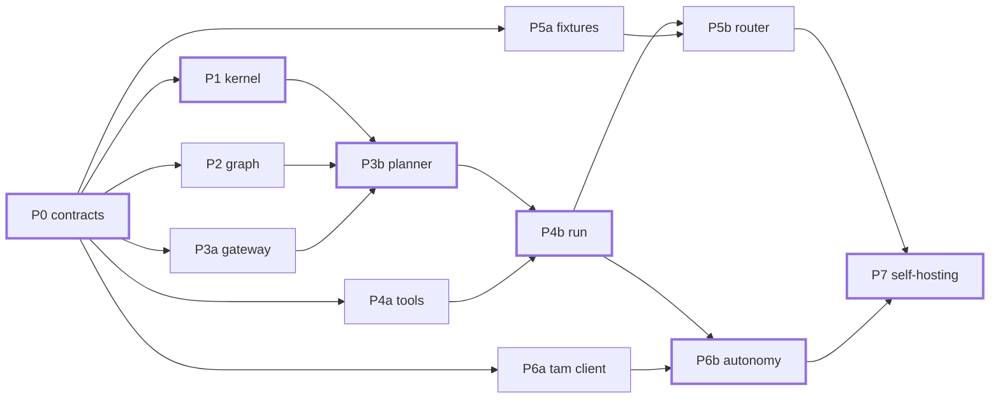

# Purser v1: implementation plan

Nov 20, 2026 · @Luki

Companion to Doc.

## Summary

Everything in the design ships in eight slices, P0 to P7, as 66 small work packages. Each package is built by one agent, tested by the other and approved by you, and each slice closes on a quality gate, not a date.

- **You** are the architect and approver: contracts, designs, phase gates and merges of anything that changes a contract.
- **Codex** builds the hard core (kernel, store, scheduler, planner, Git effects, model gateway) and reviews Antigravity's work.
- **Antigravity on Gemini 3.8 Flash** writes tests from contracts, builds well-specified plumbing (CLI, codegen wrappers, indexing, observers, MCP, tam) and reviews Codex's work. Google positions 3.8 Flash for long-horizon software engineering, and it is now the Antigravity agent's default model. [source](https://ai.google.dev/gemini-api/docs/latest-model)
- **One rule above all:** the agent that implements a package never writes the tests that close it and never reviews it. This is the design's "evidence closes work" principle, applied to building Purser itself.

Order of work: contracts first, then the kernel and the system graph in parallel, then planning, execution, routing and autonomy. Purser tracks its own build from the end of P1, plans its own packages from P3, runs them from P4 and builds a whole milestone by itself at P7.

The plan deliberately avoids what derailed purser-main: no package larger than a day of agent work, no experiment harness beyond the design's four benchmarks, and scope and frozen tests checked by CI from day one.

## Who does what

Every package moves through the same five hand-offs, and no agent ever holds two of the roles that close its own work.

&#91;embedded content: package flow · 6 hand-offs, 3 return paths\]

Tests are frozen before the builder starts, so the code is written to the contract, never the other way round.



| Package built by | Tests written by | Reviewed by | Merged by |
| --- | --- | --- | --- |
| Codex | Antigravity, from the contract | Antigravity, against the contract | Size S: automatically, on green CI and the reviewer's approval. M and L: you |
| Antigravity | Codex, from the contract | Codex, against the contract | Size S: automatically, on green CI and the reviewer's approval. M and L: you |
| Either, when it changes a contract | Both re-check affected tests | Both | You, always |

Why this split: Codex goes where reasoning density is highest and mistakes are costliest, the kernel and the scheduler. Antigravity goes where breadth and speed pay: tests, wrappers, fixtures and plumbing, often several agents at once in its Agent Manager. Each reviews the other, so neither grades its own work.

## Ground rules for the agents

The agents get the same rules Purser will later enforce: a brief per package, a write scope, frozen tests and CI that refuses anything outside them.

Repository layout:

```text
purser/
  AGENTS.md                 # the map, under 100 lines; read by Codex and Antigravity
  docs/design.md            # export of the design doc
  docs/plan.md              # export of this plan
  docs/packages/P1-03.md    # one brief per package, with front-matter (scope, tests)
  contracts/                # JSON Schemas, contract YAML, OpenAPI
  testdata/vectors/         # conformance vectors ported from purser-main
  cmd/purser/               # CLI entry point
  internal/kernel/ ...      # packages as named in the design's architecture table
  scripts/check-scope       # diff paths must sit inside the brief's write scope
  scripts/check-frozen      # frozen tests change only in test packages
  .github/workflows/ci.yml
```

AGENTS.md, kept short and pointing elsewhere:

```markdown
# Purser: rules for coding agents
Read docs/design.md (what) and your package brief in docs/packages/ (your task).
1. Work only inside the brief's write scope. CI rejects anything else.
2. Never edit frozen tests or contracts. If they look wrong, stop and escalate.
3. Escalate by writing docs/packages/<id>.contradiction.md and commenting on the tam task.
4. Reuse what the brief lists; add no new dependency without approval.
5. Done means: frozen tests pass, go test -race passes, lint is clean, coverage floor holds.
6. Larger than the brief's budget? Stop and propose a split.
Commands: make check | make test | make fuzz | make bench
```

Package brief template:

```yaml
id: P1-03
title: Gate
contract: contracts/kernel/gate.yaml@v1
scope:
  write: [internal/kernel/gate/**]
  read:  [internal/kernel/**, contracts/**, testdata/vectors/admission/**]
reuse: [kernel.Encode, store.Transact]
tests_frozen: [internal/kernel/gate/gate_test.go, testdata/vectors/admission/**]
builder: codex
test_author: antigravity
reviewer: antigravity
done_when: [frozen tests pass, race clean, lint clean, package coverage >= 85%]
budget: {changed_lines: 600, excluding: tests}
```

CI gates on every pull request:

- `go build`, `go vet` and golangci-lint with depguard layer rules;
- `go test -race ./...`, plus a 30-second fuzz smoke on codec and gate (one hour nightly);
- conformance vectors and the coverage floor for kernel packages;
- `check-scope` and `check-frozen` against the package brief;
- the read-latency benchmark from P1 on, so the quadratic replay cannot return.

Larger packages (size M or L) start with an execution plan checked into the brief, which Codex and Antigravity both support. Anything an agent cannot settle within its contract becomes a contradiction file and a tam comment, and the agent stops.

The sketches above are superseded by planning batch 1: its `AGENTS.md`, `docs/packages/_template.md` and `tools/briefcheck` (P0-02) are the versions the agents follow. Until P0-02 lands, `tools/check_briefs.py` validates the briefs.

## Streams and dependencies

The critical path runs through the kernel: P0 contracts, P1 kernel, P3 planner, P4 execution, then P6 autonomy and P7 self-hosting. Everything else runs beside it.

&#91;embedded content: streams · 7 lanes, 6 steps on the critical path\]

The "a" boxes are each phase's early packages; the "b" boxes are the parts that must wait for the kernel or for real runs.



- **Starts right after P0:** the system graph (P2), the model gateway and context packs (early P3), generators and observers (early P4), the leaf-bench fixtures (early P5) and the tam client (early P6).
- **Waits for the kernel:** the planner's sessions, the scheduler and the leaf loop, because they write through the gate.
- **Waits for real runs:** router learning and the feature, trap and recovery benchmarks, because they measure what P4 executes.

## P0 Foundations and contracts

P0 turns the design into machine-checkable contracts and a repository that enforces the rules; nothing else starts until its schemas are approved.

| ID | Package | Output | Builds | Tests and review | Size | After |
| --- | --- | --- | --- | --- | --- | --- |
| P0-01 | Repository bootstrap | Go module, layout, AGENTS.md, Makefile, CI, golangci config with depguard layer rules; purser-main moved to `reference/python/` | Codex | You | M | — |
| P0-02 | Scope and frozen-test checks | `briefcheck`: brief validation, scope, frozen tests, the `red` check and the auto-freeze tag for size S | Antigravity | Codex | M | P0-01 |
| P0-03 | Record schemas | JSON Schemas and Go envelope types for every wire shape, the sixteen v1 record kinds, the v2 kinds and the graph node and edge | Codex | Antigravity | M | P0-01, P0-06 |
| P0-04 | Contract schema v1 | `contract.v1` for data types, functions, modules, endpoints, events and UI components, plus a validator | Codex | Antigravity, from the design's examples | M | P0-03 |
| P0-05 | Tool and CLI schemas | Tool contract schema; JSON output schema for every CLI command; exit codes | Antigravity | Codex | S | P0-03 |
| P0-06 | Conformance vectors and golden logs | purser-main vectors copied byte for byte, plus golden event logs recorded from its own test scenarios | Antigravity | Codex, checked against purser-main's own checker | M | P0-01 |
| P0-07 | Quality harness | Coverage floors, fuzzing and benchmark-ratio checks in CI | Codex | Antigravity | S | P0-01 |

**Gate:** schemas validate every example in the design, vectors are translated and cross-checked against purser-main, and CI rejects out-of-scope edits and changed frozen tests.

## P1 Kernel in Go

P1 ports purser-main's kernel semantics to Go with the fast read path. Antigravity writes every kernel test from the vectors before Codex writes the code.

| ID | Package | Output | Builds | Tests and review | Size | After |
| --- | --- | --- | --- | --- | --- | --- |
| P1-01 | Event codec and hash chain | Canonical encoding, digests, `VerifyChain` | Codex | Antigravity | S | P0-03, P0-06 |
| P1-02p | Projection: records and reducers | Projection model, sort order, checksums; pure reducer registry with the M1 events | Codex | Antigravity | M | P1-01 |
| P1-02a | Store: schema and transactions | SQLite WAL; one transaction writes receipt, events and projections | Codex | Antigravity, with interrupted-write tests | M | P1-01, P1-02p |
| P1-02b | Store: projection reads | Snapshot served from materialized projections plus a head-hash check | Codex | Antigravity | M | P1-02a |
| P1-02c | Store: replay and verification | `replay`, chain verification, read benchmark to 100k events | Codex | Antigravity | S | P1-02b |
| P1-03 | Gate | Identity binding, admission, idempotent redelivery, id conflicts, stale bases, receipts; M1 operators including approvals | Codex | Antigravity | M | P1-02a |
| P1-04 | Work model | Work, result, obligation, run, observation and evidence operators (producer is never observer); artifact store; `work.spec` | Codex | Antigravity | M | P1-03 |
| P1-05 | Closure and work view | Outcome digests, closure on the exact candidate, q01–q10 answers, frontier; `work.close` and `work.accept` | Codex | Antigravity | M | P1-04 |
| P1-06 | Impact and invalidation | Recursive dependency query; stale dependents only; parent coverage | Codex | Antigravity | M | P1-05 |
| P1-07 | Decisions and dispatch | Assumptions, decisions, dependencies, premise observations with local invalidation, dispatch | Antigravity | Codex | M | P1-06 |
| P1-08a | Effect operators | Slots, grants, intents, authorization cutoffs, reconciliation of uncertain outcomes | Codex | Antigravity | M | P1-05 |
| P1-08b | Git effect adapter | Guarded reftable transactions, protected receipts, independent observer | Codex | Antigravity | M | P1-08a |
| P1-09 | Kernel CLI | `init`, `propose`, `status`, `why`, `replay`, `frontier`, `context`, `graph --work`, all with `--json` | Antigravity | Codex, with golden files | M | P1-05, P0-05 |
| P1-10 | Hardening | Fuzz targets, crash-and-replay suite, end-to-end lifecycle through the CLI, race runs | Antigravity | Codex | S | P1-07, P1-08b, P1-09, P0-07 |

**Gate:** all conformance vectors pass, the suite is race-clean, one hour of fuzzing finds nothing, reads stay flat to 100,000 events, and `status` and `why` answer with every model off. From here, every package is also recorded as a work item in Purser's own kernel.

## P2 System graph

P2 builds the map of the code that every later role reads instead of files. It runs in parallel with P1 because it needs only the SystemNode schema.

| ID | Package | Output | Builds | Tests and review | Size | After |
| --- | --- | --- | --- | --- | --- | --- |
| P2-01 | Graph store and query API | Derived index of symbols and edges with a deterministic digest | Codex | Antigravity | M | P0-03 |
| P2-02 | SCIP ingestion | scip-go and scip-typescript run as tools; definitions, references and relationships loaded | Antigravity | Codex | M | P2-01 |
| P2-03 | Syntax fallback | Files, declarations and imports for Go (`go/parser`) and TS (TypeScript compiler API) when no index exists; replaces tree-sitter, whose Go bindings need cgo | Antigravity | Codex | M | P2-01 |
| P2-04 | Language-server client | gopls and the TypeScript server: references, signatures, rename previews | Codex | Antigravity | M | P2-01 |
| P2-05 | Incremental update | Re-index changed files after a merge; digest equal to a full index | Codex | Antigravity | M | P2-02, P2-03 |
| P2-06 | Test coverage edges | covered-by edges from Go and vitest coverage per test | Antigravity | Codex | M | P2-02 |
| P2-07 | Reuse finder | Equivalent symbols by name, signature and text; sqlite-vec later | Codex | Antigravity | M | P2-02 |
| P2-08 | Index CLI, snapshot record and benchmark | `purser index`, graph queries, `graph.snapshot` recorded in the kernel; runs on one of your own Go projects and one of your own TypeScript projects | Antigravity | Codex | M | P2-04 to P2-07, P1-09 |

**Gate:** both benchmark repositories index cleanly, the reuse finder catches deliberately seeded duplicates, and an incremental update is clearly faster than a full index.

## P3 Plan and validate

P3 gives Purser its architect and module lead, plus the deterministic validator that decides when a plan is done. CI never calls a live model: model tests run on recorded fixtures.

| ID | Package | Output | Builds | Tests and review | Size | After |
| --- | --- | --- | --- | --- | --- | --- |
| P3-01 | Model gateway | Provider interface; Bedrock for Anthropic models; OpenAI-compatible endpoints; caching, retries, metering, structured output | Codex | Antigravity, with recorded fixtures | M | P0-03 |
| P3-02 | Context pack builder | Contract, neighbours' interfaces, decisions, reuse targets, tests, budget; size limits | Codex | Antigravity | M | P1-05, P2-07, P0-04 |
| P3-03 | Architect session | Plan bundle, `contract.register`, prompt pack and output schemas for decisions, contracts, module work graph, acceptance tests; proposals through the gate | Codex | Antigravity, with golden tasks | L | P1-07, P3-01, P3-02, P0-04 |
| P3-04 | Module-lead session | Function contracts, unit test specs, leaf nodes | Codex | Antigravity, with golden tasks | M | P3-03 |
| P3-05 | Validator: graph checks | Checks 1–9, 11 and 12 from the design's definition of done | Antigravity | Codex | M | P0-04, P1-05, P2-07, P3-03 |
| P3-06 | Stub and test-skeleton generators | Go and TS templates from function and module contracts | Antigravity | Codex | M | P0-04 |
| P3-07 | Validator: compile check | Check 10: the skeleton builds and its tests fail on the stubs, in a container | Codex | Antigravity | M | P3-06 |
| P3-08 | Planning CLI | `task new`, `plan`, `validate`, `approve`, `reject`, `graph --test` and `--contracts` | Antigravity | Codex | S | P3-04, P3-05, P3-07 |
| P3-09 | Planning trial | Five feature-bench tasks planned end to end; you review each plan | Codex | You | S | P3-08 |

**Gate:** five valid plans that you approve without rewriting. From here, Purser plans the packages of the next phases and you approve them.

## P4 Generate and run

P4 is where Purser starts doing the work: tools generate the skeleton, workers fill it, observers produce evidence and the scheduler runs waves. Its last package delivers a whole feature end to end.

| ID | Package | Output | Builds | Tests and review | Size | After |
| --- | --- | --- | --- | --- | --- | --- |
| P4-01 | Generator tools | oapi-codegen, openapi-typescript or orval, sqlc, buf, gqlgen, mockery and JSON Schema types, each behind a tool contract | Antigravity | Codex | M | P0-05 |
| P4-02 | Worktrees and isolation | One worktree per node; tests in containers (Docker on WSL2); kernel and credentials out of reach | Codex | Antigravity | M | P1-08b, P3-07 |
| P4-03a | Observers: scope, build, tests | Scope check, build and type checks, node tests plus regression tests from covered-by edges | Antigravity | Codex | M | P2-06, P4-02 |
| P4-03b | Observers: conformance, reuse | Signatures and types against the contract; examples; no duplicate symbols | Codex | Antigravity | M | P2-07, P4-02, P3-06 |
| P4-03c | Observers: lint and architecture | golangci-lint with depguard; eslint and dependency-cruiser; layer rules from module contracts | Antigravity | Codex | S | P4-02 |
| P4-04 | Scheduler | Frontier, waves with non-overlapping scopes, budgets, parallelism limits | Codex | Antigravity | M | P1-06, P1-07 |
| P4-05 | Leaf loop | Structured output, apply, compile and test, retry within budget, submit | Codex | Antigravity | M | P3-01, P3-02, P4-02 |
| P4-06 | Test-author role | Tests from contracts only, frozen by digest | Codex | Antigravity | M | P4-05, P3-06 |
| P4-07 | Integrator, review package, reviewer | Bottom-up integration; compact review package; evidence report | Codex | Antigravity | M | P4-03a to P4-03c, P4-04, P3-01 |
| P4-08 | MCP server | Context pack, submit, contradiction and graph-query tools for any agent | Antigravity | Codex | M | P3-02, P2-08 |
| P4-09 | Worker adapters | Headless OpenCode sessions; Codex exec | Antigravity | Codex | M | P4-08, P4-02 |
| P4-10 | Contradiction and local re-plan | Escalation to the contract's owner; only dependents go stale | Codex | Antigravity | M | P4-04, P1-06, P3-04 |
| P4-11 | `purser run`, first feature | One feature-bench task delivered end to end with evidence | Codex | Antigravity; you accept | M | P4-01 to P4-10, P3-09 |

**Gate:** one feature-bench task delivered end to end, closed on evidence only. From here Purser executes its own remaining packages, and Codex and Antigravity connect to it as workers through the MCP server.

## P5 Router, cost and benchmarks

P5 makes Purser cheap and proves it against the baselines. The benchmark fixtures can start early; the measurements wait for P4.

| ID | Package | Output | Builds | Tests and review | Size | After |
| --- | --- | --- | --- | --- | --- | --- |
| P5-01 | Triage | Level 0–3 classification by rules plus a small model; human override | Codex | Antigravity | S | P4-11 |
| P5-02 | Tier routing and escalation | Local, then Haiku, then Sonnet; three attempts per tier; contract flagged on repeat | Codex | Antigravity | S | P5-01, P4-10 |
| P5-03 | Local models | Ollama or llama.cpp on the RTX 5070 Ti; health in `purser models` | Antigravity | Codex | S | P3-01 |
| P5-04 | Cost metering and reports | CostRecord per call; `purser cost` by role and tier | Antigravity | Codex | S | P3-01, P1-09 |
| P5-05 | Leaf bench | 100+ function contracts with tests from your own Go and TS projects | Antigravity | Codex | L | P0-04 |
| P5-06 | Feature, trap and recovery benches | Fixtures, baseline B1 and B2 harness, metrics | Antigravity | Codex; you run the baselines | L | P4-11 |
| P5-07 | Router learning | Default tiers adjusted per contract kind from outcomes | Codex | Antigravity | M | P5-02, P5-04 to P5-06 |

**Gate:** cost per accepted change and acceptance rate measured against B1 and B2 on the feature bench, and tiers set from the leaf bench, reported even where the baseline ties.

## P6 tam autonomy, daemon and editors

P6 lets Purser take tasks from tam on its own and show up inside editors. The tam client can start early, once tam confirms MCP access for a custom client.

| ID | Package | Output | Builds | Tests and review | Size | After |
| --- | --- | --- | --- | --- | --- | --- |
| P6-01 | tam MCP client | Connection with Purser's own agent identity and permissions | Antigravity | Codex | S | P0-05 |
| P6-02 | Intake and mapping | tam task to Purser task and back; polling for ready tasks | Antigravity | Codex | M | P6-01, P1-03 |
| P6-03 | Design approval | Design attached to the task; approval by status change or comment keyword, first answer wins | Codex | Antigravity | S | P6-02, P3-08 |
| P6-04 | Progress and evidence reports | Wave updates; links to commits and PRs; final evidence report | Antigravity | Codex | S | P6-02, P4-07 |
| P6-05 | Daemon | `purser serve`: scheduler, tam sync and MCP server; restart-safe | Codex | Antigravity | M | P4-11, P6-02, P4-08 |
| P6-06 | ACP server | Purser as an agent in Zed, JetBrains and Neovim | Antigravity | Codex | M | P6-05 |
| P6-07 | Field log | Per-task metrics plus bypasses and their reasons | Antigravity | Codex | S | P6-04, P5-04 |

**Gate:** one week of real tasks taken from tam and closed on evidence, with every bypass logged.

## P7 Self-hosting, and what stays for later

P7 is the proof: Purser plans and builds a real milestone of itself, with you approving the design only.

| ID | Package | Output | Builds | Tests and review | Size | After |
| --- | --- | --- | --- | --- | --- | --- |
| P7-01 | Python support, built by Purser | scip-python, pyright and datamodel-code-generator wired into graph, generators and observers | Purser | Purser's test-author role and observers; you approve the design | L | P5-07, P6-06, P6-07 |
| P7-02 | v1.0 release review | Field log and benchmark results reviewed; release notes from evidence | Purser drafts | You | S | P7-01 |

Later, after v1.0: the web UI (plan, graph, evidence and cost views over HTTP with server-sent events), more languages, and contributors' packages run through the same rules.

## First two weeks

The first two weeks finish P0 and the first half of P1, with both agents busy in parallel from day one.

**Definition first.** Your time is the bottleneck, so definition is front-loaded. Before the agents start building, you and Codex draft every brief and contract for P0 to P2, plus the boundary contracts of P3 to P7, and you approve them in one or two sittings. Detail inside the P3 to P7 modules is still added just in time, because P1 and P2 will teach us things; each later batch reaches you as one approval, not a stream of small ones.

The rule that follows: no code is written for any phase until that phase's detailed plan is approved. A detailed plan means every package's brief and contract are written and its tests are frozen. P3 to P7 each get their own planning batch at the start of the phase.

**Planning batch 1 is drafted.** All 66 briefs are written as repository files (`docs/packages/<id>.md` with machine-checked front matter): P0 to P2 in full with status `ready`, P3 to P7 in full with status `draft`. Beside them sit 26 contracts (13 kernel, 8 graph, 5 boundary contracts for P3 to P7), the record and contract formats, AGENTS.md and a validator. The batch also fixes the freezing flow: the test author's branch is tagged `frozen/<id>` once every acceptance test fails on stubs (automatically for size S, after your approval for M and L), and the builder branches from that tag.

- [ ] You: create the repository, the tam project and board; export the design and this plan into `docs/`.
- [ ] You and Codex: draft all P0 to P2 briefs and contracts, plus the P3 to P7 boundary contracts; Antigravity checks the batch for gaps and contradictions.
- [ ] You: approve that batch in one or two sittings. From here, your time goes mainly to phase gates and contradictions.
- [ ] Codex: P0-01 repository bootstrap. You review and merge.
- [ ] Antigravity, in parallel: P0-06 conformance vectors from purser-main.
- [ ] Codex: P0-03 record schemas. You approve them before anything builds on them.
- [ ] Antigravity: P0-02 scope and frozen-test checks; CI starts enforcing briefs.
- [ ] Codex: P0-04 contract schema; Antigravity writes its tests from the design's examples first.
- [ ] Antigravity: P0-05 tool and CLI schemas. Codex: P0-07 quality harness.
- [ ] P0 gate review with you.
- [ ] Antigravity: tests for P1-01, P1-02a and P1-03 from the vectors, frozen before any code.
- [ ] Codex: P1-01, then P1-02a, then P1-03 against those frozen tests.
- [ ] In parallel: Codex starts P2-01; Antigravity starts P2-02 tests and the P5-05 leaf-bench fixtures.

Kickoff prompt for Codex:

```text
You are building Purser, an agentic engineering runtime in Go. Read AGENTS.md, docs/design.md
and your brief docs/packages/<id>.md. Write an execution plan in the brief for size M or L.
Work only inside the brief's write scope. Make the frozen tests pass without editing them.
If the contract or tests look wrong, write docs/packages/<id>.contradiction.md and stop.
Finish with: make check green, a short evidence note in the PR, and nothing outside scope.
```

Kickoff prompt for Antigravity, test-author role:

```text
You write tests for Purser package <id>. Read AGENTS.md, docs/design.md, the contract named
in docs/packages/<id>.md and the vectors it lists. Write tests from the contract only; do not
read or write any implementation. Cover examples, errors, edge cases and the contract's
pre- and postconditions. Tests must compile against the generated stubs and fail on them.
Open a PR that touches only the brief's test paths.
```

## Tracking and dogfooding

Every package is a tam task from day one, and Purser takes over more of its own tracking at each gate.

Board columns, in order: Backlog, Brief ready, Tests frozen, In progress, Review, Done, plus Blocked for contradictions. Each task links its brief and carries three labels: phase, builder and size.

| From the end of | Purser does for its own build |
| --- | --- |
| P1 | Records every package as a work item; CI runs become its evidence; `purser status` and `why` show the build's state |
| P2 | Indexes its own repository; reuse checks run on every package |
| P3 | Plans the packages of later phases; you approve them |
| P4 | Executes packages; Codex and Antigravity join as workers through its MCP server |
| P6 | Takes its own tasks from tam and reports back |
| P7 | Builds a whole milestone with you approving the design only |

## Risks to the build

The biggest risk is repeating purser-main: agents producing process and harness faster than product.

| Risk | Effect | How the plan contains it |
| --- | --- | --- |
| Scope drift | Packages grow, side work appears | Briefs with write scopes; `check-scope` in CI; 600-line budget; split instead of grow |
| Tests bent to fit code | False green builds | Tests written first by the other agent and frozen; `check-frozen` in CI |
| Flash on intricate logic | Subtle bugs in the core | Kernel, scheduler and planner stay with Codex; Antigravity builds well-specified packages under Codex review |
| Your review time becomes the bottleneck | Merges queue up | You review contracts and gates closely; small packages need green CI plus the other agent's review |
| Contract churn | Rework across packages | Contracts versioned; changes are decisions you approve; dependents marked stale |
| Windows environment | Containers and Git features behave differently | Develop under WSL2; Git 2.45 or newer for reftable, which the Git effects need |
| Subscription limits | Agents stall mid-phase | Work spread across both agents; Bedrock used only by Purser's own runtime from P3 |
